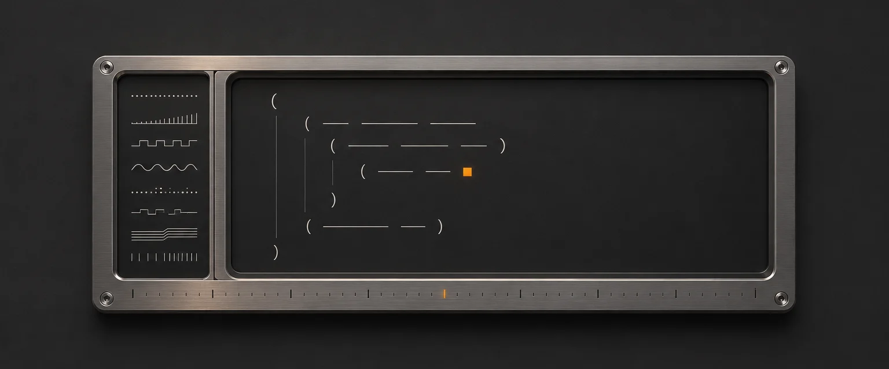
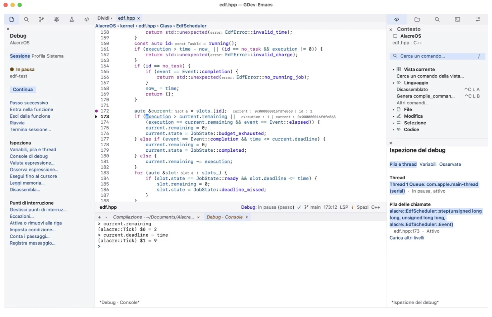
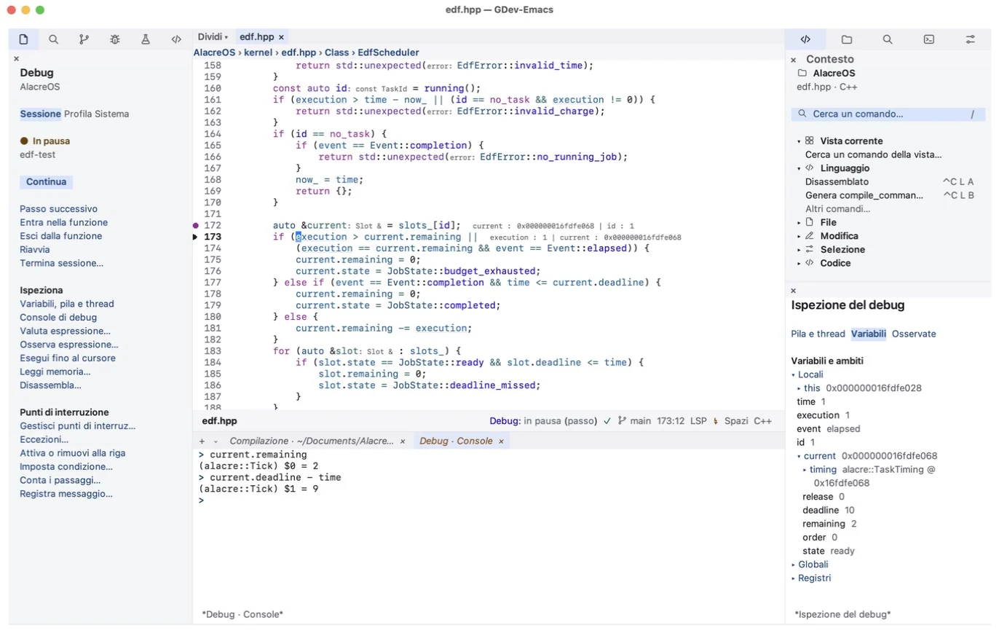

# GDev-Emacs

**Un banco di lavoro personale, costruito su Emacs.**

File a sinistra, codice al centro, strumenti in basso. Ogni progetto ritrova
la sua disposizione. I menu e le guide sono in italiano, i moduli si scelgono
in Lisp e i fork inclusi si possono leggere e modificare nel repository.



[Installa](#installa-e-apri-un-progetto) · [Apri il banco di lavoro](https://gipidevdor.github.io/GDev-Emacs/) · [Scorciatoie](docs/keymap.md)

Per gli agenti IA sono disponibili due skill e un server MCP locale.
Consulta [GDev-Emacs per agenti](docs/agenti.md).
Per contribuire, vedi [architettura e criteri di qualità](docs/architettura.md).

Il [progetto formale](docs/assicurazione/progetto-formale.md) integra requisiti, tassonomie, schede operative, modelli, procedure riprendibili e rapporti. GDev usa la stessa struttura per la propria distribuzione, con [prove di affidabilità riproducibili](docs/assicurazione/autoverifica.md).

## Installa e apri un progetto

Su macOS servono [Homebrew](https://brew.sh) e gli strumenti da riga di comando
di Apple. Installali con `xcode-select --install`, poi esegui questo comando
dalla cartella dei sorgenti.

```bash
./bin/gdev-bootstrap-macos
```

Il programma d'installazione prepara Emacs e gli strumenti di sviluppo, collega questa cartella a
`~/.config/emacs` e rende disponibile il comando `gdev` in `~/.local/bin`.
Puoi rieseguirlo per completare un'installazione interrotta.
Se manca uno strumento, `gdev doctor` indica come installarlo.
I moduli usano i fork Lisp mantenuti in questo repository, già disponibili
al primo avvio. [Dipendenze e licenze](docs/dipendenze.md)

Apri Emacs e scegli **Apri cartella…** (`⇧⌘O`) dal cruscotto. Premi `⌘P`
per trovare un file. In un progetto C o C++, `F7` avvia la compilazione.
La compilazione mostra i risultati in basso e lascia il cursore nel codice.
Premi `F8` per andare al problema successivo.

## Muoviti nel progetto

| Scorciatoia | Azione |
| --- | --- |
| `⌘P` | Cerca un file anche per nome abbreviato, salta a `:42`, trova un `@simbolo` o esegue un `>comando` |
| `⇧⌘P` | Apre la ricerca dei comandi |
| `C-c g g` | Apre Hit per il repository attivo |
| `⇧⌘F` | Cerca testo nei file dello spazio di lavoro e aggiorna i risultati in secondo piano |
| `C-c p s` | Cerca un simbolo nei file indicizzati dal server di linguaggio |
| `⌘S` | Salva il documento, anche dal pannello |
| `⌘B` | Mostra o nasconde il riquadro laterale |
| `⌥⌘B` | Mostra o nasconde [Comandi a destra](docs/workflows.md#comandi-a-destra) |
| `C-c w T` | Passa tra Comandi ed editor o apre la ricerca a finestra stretta |
| `C-c w v` | Sceglie una vista laterale |
| `C-c d W` | Apre Debug dello spazio con sessione, profilazione e risorse |
| `⌘J` | Mostra o nasconde il pannello degli strumenti |
| `⇧⌘J` | Passa a uno strumento già aperto |
| `⇧⌘T` | Riapre l'ultima scheda chiusa nello spazio corrente |
| `C-c t z` | Centra il documento. Premilo di nuovo per riaprire i riquadri |
| `⌘,` | Apre le preferenze e le scorciatoie |

## Riprendi da dove eri

Il terminale continua a lavorare anche quando nascondi il pannello. Passando
da un progetto all'altro ritrovi la disposizione delle finestre di ciascuno.
Quando avvii GDev senza aprire un file, l’ultima sessione ripristina i file
locali, le posizioni del cursore e le bozze salvate. Puoi riprenderla anche
con **Riprendi ultima sessione** (`C-c q l`).

## L'interfaccia sul Mac

Le etichette usano il carattere di sistema, il codice usa SF Mono.
L'interfaccia segue l'aspetto chiaro o scuro di macOS. Nei menu trovi le
azioni disponibili nella vista attiva. Se preferisci la tastiera, premi
`C-c` e una lettera e attendi un istante per vedere i tasti del gruppo.
Opzione sinistra funziona come Meta. Con Opzione destra puoi scrivere
`[ ] { } @ #`.

## Strumenti di sviluppo

- **C e C++** con completamento e segnalazioni di clangd, compilazione, test, esecuzione passo passo e profilazione.
- **Common Lisp** con SBCL e SLY, un interprete interattivo e la HyperSpec consultabile senza connessione.
- **Perl** con test, formattazione, diagnostica e profilazione.
- **Python** con ambienti virtuali, completamento, controlli e formattazione, test, esecuzione passo passo e distribuzione dei pacchetti.
- **Database SQL e XML** con esplorazione, console ed esecuzione di script per PostgreSQL e SQLite, completamento XML e convalida con gli schemi.
- **Go, Rust, Swift, Zig, Java e C#** con compilazione, test, esecuzione e navigazione tramite i rispettivi strumenti.
- **Terraform e Kubernetes** con validazione e piani, viste delle risorse del cluster e log.
- **Sviluppo di siti e terminale** con supporto per JavaScript e TypeScript, interprete dei comandi del progetto e accesso via SSH.
- **Git con Hit, GitHub con HitHub e agenti** dall'area di modifica, con viste dedicate per differenze, controlli e sessioni.

Con **Progetto › Esegui attività…** puoi richiamare per nome i comandi che usi
spesso. Prima di salvare, **File › Confronta con il file salvato** mostra le
differenze tra il documento aperto e la copia su disco.

### Una sessione di debug

Un profilo di avvio compila il test dello scheduler EDF di AlacreOS e lo apre
con LLDB. `F5` si ferma al punto di interruzione della riga 172 e un passo porta
alla 173: l'editor mostra i valori accanto al codice, **Debug** a sinistra offre
i passi e **Ispezione del debug** a destra riunisce thread e pila delle chiamate.

<picture>
  <source media="(prefers-color-scheme: dark)" srcset="docs/assets/debug-alacreos-scuro.webp">
  
</picture>

Nella scheda **Variabili** apri un riferimento per leggerne i campi. La console
valuta espressioni nel livello selezionato della pila.

<picture>
  <source media="(prefers-color-scheme: dark)" srcset="docs/assets/variabili-alacreos-scuro.webp">
  
</picture>

Le immagini sono catture della finestra nativa di Emacs su macOS, con il tema
chiaro e scuro di GDev.

## Documentazione

- Per aprire un progetto, usare gli strumenti e riprendere la sessione, consulta i [flussi di lavoro](docs/workflows.md).
- Premi `C-c i s` per cercare i frammenti del linguaggio corrente. La [guida al catalogo](docs/snippets.md) raccoglie pattern di progettazione, idiomi commentati e ricette.
- Per trovare una scorciatoia, consulta la [mappa dei tasti](docs/keymap.md). In Emacs, premi `C-h d k` per aprirla o `C-h d m` per consultare l'aiuto di un modulo.
- Per imparare Emacs in italiano, apri la [guida a Emacs](docs/emacs.md) con `C-h d g` o inizia l'esercitazione ufficiale con `C-h d i`.
- Per conoscere provenienza, versioni e licenze dei componenti inclusi, consulta [Dipendenze e licenze](docs/dipendenze.md).
- Per seguire le priorità di sviluppo, consulta la [tabella di marcia](docs/roadmap.md).
- Per l'[assicurazione ingegneristica](docs/assicurazione/README.md), apri **Progetto › Assicurazione del progetto** (`C-c p i`): transazioni, standard, prove e proposte degli agenti sono nello stesso [Workbench](docs/assicurazione/workbench.md). La CLI parte da `gdev assurance status`.

## Scegli cosa caricare

La tua configurazione sta in `~/.config/gdev` (o `$GDEV_USER_DIR`), fuori dall'archivio dei sorgenti. Puoi
versionarla a parte e conservarla tra un aggiornamento e l'altro.

| File | Contiene |
| --- | --- |
| `init.el` | Moduli attivi e opzioni nel blocco `gdev!` |
| `packages.el` | Pacchetti aggiuntivi, uno per chiamata a `gdev-package` |
| `config.el` | Impostazioni personali, caricate per ultime |

```elisp
(gdev! :editor (format +onsave) fold
       :ui workbench
       :lang cc perl
       :config default)
```

Trovi l'elenco dei moduli nel [modello di configurazione](templates/init.el).
Dopo aver modificato `init.el` o `packages.el`, esegui `gdev sync` e premi
`C-c q R` per riavviare Emacs e ripristinare la sessione.

Il modulo `:ui workbench` attiva tema, caratteri, menu in italiano e gestione dei
riquadri e delle aree di testo. Le configurazioni che usano `popup` attivano lo stesso modulo.
`gdev compile` genera il codice intermedio dell'interfaccia in `modules/ui/workbench/`.

`gdev compile` e `gdev sync` compilano anche i file privati presenti. I rispettivi
`.elc` vengono salvati accanto ai sorgenti. Se modifichi un `.el`, al prossimo
avvio Emacs carica il sorgente più recente. Dopo un aggiornamento, esegui
`gdev compile --native` per rigenerare il codice compilato.
`gdev clean` rimuove i file compilati.

`GDEV_STATE_DIR` cambia la cartella di stato. Puoi usarne una separata
per eseguire prove in un'istanza isolata. `GDEV_TOOLS_DIR` cambia la cartella
dei programmi di supporto installati dal programma d'installazione.

## Profili e moduli personali

Un modulo personale vive in `~/.config/gdev/modules/CATEGORIA/NOME/config.el`.
Attivalo in `gdev!` nel tuo `init.el`. Se ti serve un pacchetto aggiuntivo,
dichiaralo in `packages.el`. Dopo `gdev sync`, trovi il modulo in `C-h d m`.
Un modulo che fallisce durante l'attivazione viene segnalato da `gdev doctor`.
I registri GDev pubblicano le sue capacità una volta riuscito il caricamento.
Durante la valutazione di `config.el`, `gdev-module-status` restituisce
`loading`. Usa `gdev-register-after-module` per le operazioni che devono
vedere il modulo `active` e i suoi nuovi gestori. Se annulli un tentativo
durante la valutazione, resta disponibile l'esito precedente.

Le azioni di un modulo possono comparire in **Comandi** e in **Strumenti › Moduli**
con una sola dichiarazione in `config.el`. Usa un identificatore del modulo,
il nome del gruppo, un’icona in `icons/` e i comandi interattivi già definiti.

```elisp
(gdev-set-tool-actions 'note-di-lavoro "Note di lavoro" "notes"
  ["Apri le note…" mie-note-apri]
  ["Registra una voce…" mie-note-registra :visible (derived-mode-p 'org-mode)])
```

I predicati facoltativi `:visible` e `:active` si valutano nella vista in uso.
Le azioni locali di una vista possono usare `gdev-context-items` e i linguaggi
continuano a pubblicare le proprie scorciatoie tramite `gdev-localleader`.

Per provare un profilo con configurazione, cache e sessioni proprie:

```sh
gdev --profile laboratorio install
gdev --profile laboratorio emacs
```

Una configurazione personale già esistente può attivare i nuovi moduli
copiando le voci desiderate da [templates/init.el](templates/init.el).

## Tieni in ordine l'installazione

| Azione | Comando |
| --- | --- |
| Allineare i pacchetti ai moduli attivi | `gdev sync` |
| Rigenerare il codice intermedio del nucleo, dei moduli attivi e dei file privati | `gdev compile` |
| Compilare anche il nucleo e i moduli attivi in codice nativo | `gdev compile --native` |
| Aggiornare i sorgenti e i pacchetti | `gdev upgrade` |
| Preparare un avvio da una revisione precedente | `gdev rollback [REVISIONE]` |
| Controllare strumenti e grammatiche | `gdev doctor` |
| Aggiornare l'ambiente di Emacs quando lo apri dal Dock | `gdev env` |
| Misurare i tempi di avvio | `gdev bench` |
| Rigenerare la mappa dei tasti | `gdev docs` |

GDev usa fino a quattro processi per la compilazione nativa e per le
grammatiche indipendenti. Imposta `GDEV_JOBS=1` per eseguire queste operazioni
una alla volta.

`gdev help` elenca i comandi e le opzioni. I pacchetti, la cronologia e
le sessioni salvate risiedono in `~/.local/state/gdev-emacs`.

Per usare GitHub da HitHub, apri **HitHub › Account › Accedi a GitHub**. Le istruzioni per salvare le
credenziali nel Portachiavi di macOS sono nelle sezioni [Hit e HitHub](docs/workflows.md#hit-e-hithub)
e [Agenti](docs/workflows.md#agenti).

## Licenza

GDev-Emacs è distribuito con licenza [GPL-3.0-or-later](LICENSE).
