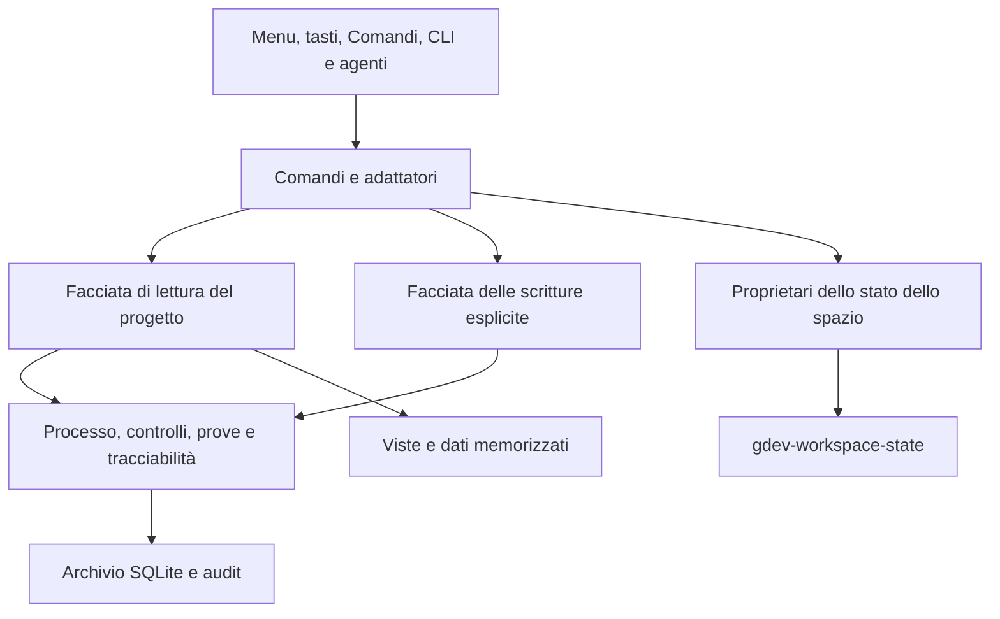

# Architettura e criteri di qualità

GDev separa configurazione, servizi del progetto, stato dello spazio e viste.
Il punto d'ingresso è `early-init.el` seguito da `init.el`: prima le cartelle
e i percorsi dei fork, poi il nucleo, i moduli dichiarati e infine le
personalizzazioni private. I moduli pubblicano comandi e capacità nei registri
comuni; menu, Comandi e scorciatoie risolvono quelle dichiarazioni.

## Responsabilità e direzione delle dipendenze

Il nucleo dell'assicurazione in `lisp/` carica senza inizializzare Emacs,
Workbench o i pacchetti personali. Le regole e l'archivio non importano
l'interfaccia. Le dipendenze differite, come le registrazioni delle
lavorazioni, si attivano quando il relativo adattatore è disponibile.

`gdev-assurance-data` possiede le letture elementari; la composizione
`gdev-assurance-project-data` restituisce un modello coerente con una sola
connessione e una sola istantanea SQL. La vista riceve dati, non connessioni.
`gdev-assurance-action-run` possiede l'entrata comune delle scritture di CLI
e Workbench. La conferma di una proposta conserva l'identità di agente e le
regole del nucleo. Il ridisegno usa il modello già ricevuto.

Le azioni dichiarano icone incluse nel repository. Il controllo dei percorsi
funziona anche in batch; se un'icona opzionale non è disponibile, la
primitiva comune conserva il testo alternativo e memorizza l'esito, senza
ripetere accessi al disco durante il ridisegno.

Ogni campo dello spazio ha un proprietario e una regola di vita in
`gdev-workspace-state-fields`. I consumatori leggono attraverso l'API;
le transizioni composte vengono pubblicate insieme. Lo stato del documento
resta nel buffer e quello della finestra nelle sue proprietà.

Le operazioni asincrone conservano identità dello spazio, cartelle e
selezione iniziale. Al completamento cercano lo spazio ancora aperto,
anche se inattivo o spostato. Il registro delle operazioni possiede lo stato
del lavoro: `gdev-workbench-operation-current` legge la registrazione
aggiornata, mentre l'oggetto restituito all'avvio può essere superato.
Un'interruzione impedisce l'attivazione automatica anche se il processo
restituisce un successo tardivo. Il completamento viene pubblicato una volta.

Le librerie `gdev-ui` e `gdev-layout` sono primitive condivise, conservate
nella cartella Workbench e disponibili al nucleo dei comandi anche quando
il modulo grafico è disattivato. Questa dipendenza intenzionale è distinta
dal nucleo autonomo dell'assicurazione. La dimensione di un file non basta
a giustificarne la suddivisione: i confini seguono dati e responsabilità.

## Dieci criteri verificabili

Le visite condivise dei grafi appartengono a `gdev-graph`, indipendente da
interfaccia e archivio. I moduli del dominio conservano regole e messaggi;
il [catalogo degli algoritmi](algoritmi-e-visualizzazione.md) ne dichiara
complessità, condizioni e verifiche. La stessa politica delle sorgenti
alimenta inventario e confronto con l'albero Git.
La [ricognizione della base](razionalizzazione-verifica.md) documenta
perimetro, modifiche, misure e controlli sui fork.

| Criterio | Riscontro eseguibile |
| --- | --- |
| Un proprietario per ogni feature | `gdev-test-architecture-features-have-one-owner`. |
| Nessun ciclo nelle dipendenze di caricamento | `gdev-test-architecture-load-dependencies-have-no-cycles`; il controllo distingue require immediati, condizionali e differiti. |
| Dominio indipendente dall'editor | Controllo delle dipendenze del dominio e `gdev-test-assurance-kernel-loads-alone`. |
| Viste separate dalla persistenza | `gdev-test-architecture-assurance-views-do-not-handle-sql-connections` e prova di una sola apertura per il modello del progetto. |
| Stato condiviso attraverso proprietari e API | Test di accesso, ciclo di vita e copertura completa di stato e flussi. |
| Risultati asincroni associati al contesto valido | Test su cambio di progetto, selezione, spazio chiuso, interruzione, duplicazione dell'esito e conservazione del fuoco. |
| Contratti d'ingresso stabili | Test ERT, contratti Python di CLI/MCP e Git, inventario `gdev audit`. |
| Caricamento e compilazione a freddo | Bytecode, compilazione nativa con avvisi e avvio ordinario isolato. Gli avvisi del codice GDev e quelli dei fork si valutano dalla loro origine. |
| Costo delle operazioni frequenti sotto controllo | Suite di latenza, barra di stato senza SQL, ridisegno da dati memorizzati e misure sulle stesse condizioni prima e dopo. |
| Verifiche ripetibili e consegna pulita | CI, `git diff --check`, documenti confrontati con le fonti e rimozione delle copie temporanee. |

I criteri definiscono cosa controllare; il loro esito va riferito alla
revisione e all'ambiente effettivamente provati. La copertura delle righe
richiesta dalla CI si affianca alle prove degli esiti e delle transizioni.
Le verifiche statiche delle dipendenze non pretendono di risolvere tutte le
chiamate Lisp dinamiche. Gli avvii ordinari e i test dei percorsi completano
quel controllo.

I [comandi di verifica](../AGENTS.md#comandi-di-verifica-dalla-radice), la
[guida dell'interfaccia](interfaccia.md) e le
[dipendenze incluse](dipendenze.md) descrivono gli altri contratti del progetto.

## Progetti formali e procedure

`gdev-project` possiede la definizione versionata; `gdev-taxonomy` ricostruisce
le gerarchie con provenienza e lacune. `gdev-project-store` registra istantanee
e controlla i passaggi. `gdev-work` collega le schede operative alle transazioni
esistenti, che restano le sole proprietarie del ciclo di vita.
`gdev-project-templates` espande modelli letterali e controlla le scritture.
`gdev-procedures` fissa i piani, registra avvii ed esiti e richiama il motore
`.lavorazione`; le esecuzioni non sostituiscono lo stato della lavorazione.
`gdev-formal` esplora invarianti finiti del nucleo. `gdev-project-report`
produce un rapporto deterministico dalle fonti. Le dipendenze verso procedure
e schede nei validatori sono differite per evitare cicli di caricamento.

La migrazione 7 estende `assurance_record` con `project` e `run`. Le scritture
restano in transazioni con audit; le letture della vista usano la facciata.
I ridisegni non leggono SQL. Le scansioni di progetti formali si svolgono in
un processo di lettura separato e i risultati vengono applicati soltanto alla
richiesta e allo spazio ancora validi. I figli delle procedure usano cartelle
di stato isolate e si arrestano attraverso il registro delle Operazioni.
