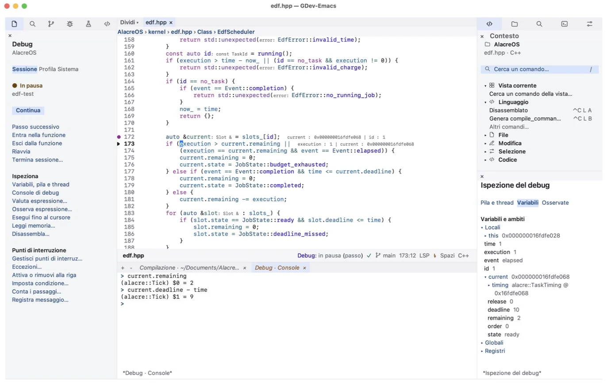

# Flussi di lavoro

Questa guida segue il lavoro quotidiano in GDev-Emacs, dall'apertura di un progetto
alla sua profilazione. Per l'installazione, consulta la [guida introduttiva](../README.md).
Per le scorciatoie, consulta la [mappa dei tasti](keymap.md).
In Emacs, **Strumenti › Tutti i comandi GDev** raccoglie i comandi dei moduli attivi
e `C-h d m` apre l'aiuto del modulo che scegli.
L'[inventario e la verifica dei flussi](ergonomia.md) affiancano ai comandi
le loro entrate e gli esiti da controllare.
La guida alle [operazioni automatiche del progetto](operazioni-progetto.md)
descrive riconoscimento delle cartelle, Make, Perl, Python e recupero dell'ambiente.

**Vai a** [Aprire un progetto](#progetti-e-spazi-di-lavoro) · [Compilare e fare debug](#esecuzione-compilazione-e-debug) · [Comporre una lavorazione](#lavorazioni) · [Usare Git](#hit-e-hithub) · [Scrivere un articolo](#scrivere-un-articolo)

## Menu contestuali

Per seguire una modifica con standard, prove e audit, apri **Progetto ›
Assicurazione del progetto** (`C-c p i`). Il catalogo degli standard è su
`C-c p I`; la [guida del Workbench](assicurazione/workbench.md) descrive
transazioni, decisioni, proposte, documenti e firme Git.

Fai clic destro in un documento, in Esplora file o in un pannello per aprire
il menu della vista. Su macOS vale anche **Ctrl-clic**. Da tastiera, usa
`Shift-F10` nella posizione corrente.

Aprire o annullare il menu conserva il gruppo attivo e la posizione del cursore.
Le azioni sulle righe seguono il puntatore. In Dired, **Rinomina…** e **Copia file…**
agiscono sulla voce cliccata. Se il clic è dentro una selezione di testo, **Copia**
continua a usare quella selezione.

**Copia percorso** e **Mostra nel Finder** sono disponibili sui file, sulle
schede e nell’albero. Da Esplora file anche **File › Mostra nel Finder** e
`C-c f y` agiscono sulla voce della riga. `C-c f y`, `C-c f l` e **Copia
percorsi relativi** partono dalla stessa cartella: quella dello spazio che
contiene il file o, fuori dallo spazio, il progetto. **Altri comandi** raccoglie i menu forniti dalla modalità
e **Cerca un comando della vista…** permette di trovarne le scorciatoie.
Usa il clic destro sulle schede per aprirle o chiuderle e sugli spazi di lavoro
per rinominarli o duplicarli. **Duplica** conserva le cartelle e i profili
selezionati. Il riquadro Debug della copia gestisce le sessioni del nuovo spazio.
Finché non lo rinomini, uno spazio prende il nome del documento nel gruppo
editor attivo, anche quando il fuoco è in Esplora file, in Comandi o in un pannello.

## Progetti e spazi di lavoro

Per creare un progetto scegli **Nuovo progetto…** sul cruscotto (lettera `c`)
o nel menu **File**. La scorciatoia è `C-c p n`. Nel menu **Progetto › Nuovo
progetto** puoi scegliere direttamente lo stesso tipo. Indica una cartella
nuova o vuota. La creazione apre la cartella nello spazio corrente.

| Tipo | Cosa trovi dopo la creazione |
| --- | --- |
| **Vuoto…** | Una cartella per i sorgenti, riconosciuta da Emacs grazie al file `.project`. |
| **Formale…** | Dopo aver indicato identificativo e nome, si apre la scheda del progetto con i campi da compilare, i requisiti e le procedure. |
| **Articolo…** | Si apre `articolo.org` con le cartelle per bozze e ricerche. |
| **LaTeX…** | Si apre `main.tex` con una bibliografia BibTeX. |

Il Workbench offre entrambi i modelli di scrittura anche nei profili precedenti.
Gli strumenti si caricano quando scegli il modello o riapri il suo documento locale.
Una cartella che contiene già file si apre dal cruscotto.

1. Dal cruscotto scegli **Apri cartella…** (`⇧⌘O`) per iniziare da una cartella, oppure **Apri
   progetto…** (`C-c w p`) per riprendere un progetto conosciuto. I progetti recenti sono
   selezionabili con le frecce e `Invio`, oppure con un clic. La cartella si apre direttamente
   in **Esplora file**, a sinistra. Quando un percorso è abbreviato, passa il
   puntatore sulla riga per leggerlo per intero. Nel menu **Cambia progetto…** premi `d`
   per mostrare il progetto in **Esplora file**. `C-c p d` mostra la cartella
   dello spazio di lavoro nello stesso albero.
2. Apri un file da **Esplora file** o cerca per nome con `⌘P`. Nell'albero, un clic o `Spazio`
   apre un'anteprima nel gruppo attivo. Doppio clic, `Invio` o una modifica la rendono
   una scheda permanente. Usa **Finestra › Sposta documento in un altro gruppo…**
   per spostarla dopo aver aperto un secondo gruppo.
3. Usa **Progetto** per compilare, eseguire o avviare i test. Per controllare il risultato,
   seleziona la scheda del pannello interessata o cercala con `⇧⌘J`.

In Emacs un'area di testo può contenere un file, un documento senza nome o il
testo mostrato da uno strumento, come i risultati di una compilazione.

Gli spazi di lavoro si conservano ogni 30 secondi, alla prima pausa nella
scrittura, e all'uscita. Il recupero periodico comprende anche cambiamenti
di schede, cartelle, documento attivo e disposizione dei gruppi, senza
richiedere una nuova modifica al testo. Dal cruscotto, **Riprendi ultima sessione**
(`C-c q l`) ripristina lo spazio attivo, i file locali con la posizione del cursore,
i gruppi di modifica, le cartelle e la vista laterale. Terminali, agenti e risultati
temporanei appartengono alla sessione in corso.

Con **Progetto › Aggiungi cartella allo spazio…** puoi riunire più cartelle.
Esplora file mostra un ramo per cartella, `⌘P` cerca in tutte e i comandi per
terminale e attività usano la cartella del documento attivo. Puoi rimuovere
una cartella dal menu **Progetto** lasciando aperti i documenti.

La voce **File › Conserva le bozze** è attiva per impostazione predefinita.
GDev conserva le modifiche nei documenti aperti ogni 30 secondi, alla prima
pausa nella scrittura, e alla chiusura.
Il pulsante rosso dell'ultima finestra, `⌘Q` e **Esci** chiudono allo stesso
modo, con la richiesta «Vuoi uscire da GDev?» e le bozze conservate.
Anche un'uscita dal comando Emacs `save-buffers-kill-emacs` conserva le bozze
locali ancora modificate, comprese quelle aggiornate dopo l'ultimo checkpoint.
Dopo un arresto anomalo le bozze restano nel salvataggio della sessione finché
non le riprendi: se inizi a lavorare senza riprenderle, GDev le conserva a parte
prima di sostituire il salvataggio, e **File › Sessione › Riprendi la sessione
interrotta** (`C-c q L`) le riporta. Una scheda salvata con bozze non viene
assorbita da una già aperta con lo stesso nome: si ripristina accanto, con la
dicitura «(bozze)».
**File › Sessione › Chiudi la finestra di Emacs** (`C-c q f`) fa lo stesso
sull'unica finestra. **Esci senza salvare** (`C-c q Q`) chiede una conferma:
le modifiche non salvate e le bozze andrebbero perse.
Quando avvii l’editor senza documenti, GDev riprende l’ultima sessione.
`⌘S` scrive le modifiche nel file originale.
Se nel frattempo quel file è cambiato sul disco, trovi il testo in una scheda
**Bozza recuperata**. Disattiva l’opzione per tornare alla richiesta di salvataggio.
Le viste, come Preferenze ed Esplora file, si riaprono dal loro stato e non
diventano bozze.

**File › Stampa…** apre il dialogo di stampa di macOS con l’anteprima. La
pagina conserva i colori, il grassetto e il corsivo dell’editor, senza la
riga corrente né la selezione, e il testo nascosto, come un blocco
ripiegato o il testo di un collegamento di Org che non si vede, non esce sulla
carta. Con il tema scuro i colori mantengono la
tinta e si scuriscono quanto basta per restare leggibili sulla carta bianca.
Gli sfondi scuri diventano tinte chiare.

Usa **Progetto › Fidati di questa cartella…** per autorizzare gli eseguibili
locali e l’ambiente del progetto. Vale anche per le versioni fissate con mise
(`mise.toml`, `.tool-versions`). L'editor resta utilizzabile durante la lettura
dell'ambiente. Il server di linguaggio può partire appena l'ambiente è pronto.
Se avvii una compilazione mentre la preparazione è in corso, GDev ti invita
a riprovare tra poco. Riapri gli altri documenti dopo aver autorizzato una
cartella. Per autorizzare la valutazione di contenuti Emacs Lisp specifici,
usa la preferenza di Emacs `trusted-content`.

### Annulla e ripeti nello spazio di lavoro

In **Modifica**, usa **Annulla operazione dello spazio** (`C-c w z`) o
**Ripeti operazione dello spazio** (`C-c w Z`). La cronologia comprende
chiusura e riapertura delle schede, modifica dei gruppi editor e sostituzioni
tra file. `⌘Z` annulla e `⇧⌘Z` ripete. In un documento modificabile
si applicano alla cronologia del testo. Nei riquadri e nelle viste in sola
lettura si applicano alla cronologia dello spazio. Le scorciatoie `C-c w z`
e `C-c w Z` scelgono sempre lo spazio anche con il cursore nel documento.
`⌘Y` resta disponibile per ripetere.
Queste scorciatoie hanno precedenza su quelle delle singole modalità.

La cronologia dello spazio conserva fino a 128 operazioni in memoria. Per le
sostituzioni conserva le righe cambiate fino a 1 MiB per operazione e 8 MiB
per spazio. I limiti per spazio sono configurabili. La cronologia del testo
dei file viene salvata su disco dal modulo Annullamento. Se un
documento o la disposizione non corrisponde più allo stato atteso, GDev ferma
l'annullamento. Le sostituzioni annullate o ripetute restano da salvare.
Git, processi e servizi remoti mantengono i propri meccanismi di recupero.

### Viste laterali

Le icone in cima al riquadro, **Vista › Attività** e `C-c w v` passano tra
Esplora file, Cerca, Hit, Debug dello spazio e Test. Puoi fare clic in tutta
l'area intorno a ciascuna icona. `⌘B` nasconde o riapre l'ultima vista dello
spazio corrente.

Apri **Cerca › Cerca nei file…** (`⇧⌘F`), scrivi il testo e premi `Invio`.
Puoi partire da una selezione su una sola riga. `Esc` chiude la richiesta.
In uno spazio vuoto il riquadro propone **Apri cartella…**.
Nel riquadro, fai clic sul testo cercato o premi `s` per cambiarlo.
Usa **Filtri…** o `f` per limitare i percorsi. I filtri attivi compaiono
sotto le opzioni. **Azzera filtri** ripete la ricerca su tutti i percorsi
ammessi dai criteri correnti.
Puoi indicare più filtri, per esempio `*.swift, *.h`. `r` alterna ricerca
letterale ed espressione regolare, `c` controlla maiuscole e minuscole,
`w` cerca parole intere e `i` include i file ignorati. I risultati sono
raggruppati per file e mostrano il testo intorno alla corrispondenza. Passa
il puntatore sul nome del file per leggere il percorso completo. Un clic
sulla riga o `Invio` apre il risultato. Le frecce `↑` e `↓`, oppure `p` e
`n`, passano direttamente tra i risultati, saltando le intestazioni.
Il cerchio accanto alla riga
o `Spazio` la selezionano, mentre `m` seleziona tutte le righe.
La selezione aggiorna solo il controllo e il riepilogo: posizione e
scorrimento rimangono stabili anche nelle ricerche con molti risultati.
Premi `v` per confrontare il testo con la sostituzione proposta e `a` per
applicarla dopo conferma. In modalità espressione regolare, puoi usare
`$1`, `$2` e gli altri gruppi di cattura. Salva i documenti modificati con `⌘S`.
Quando il riquadro è visibile, i risultati si aggiornano in secondo piano
per i file salvati, aggiunti o rimossi, anche nelle nuove sottocartelle.
Puoi cambiare il limite dei risultati tramite `gdev-search-max-results`
nelle preferenze di Emacs. Le righe troppo lunghe vengono segnalate e omesse.

### Esecuzione, compilazione e debug

Scegli un profilo da **Progetto › Scegli profilo di avvio…** o da **Debug
dello spazio** (`C-c d W`). La scelta vale per la cartella del documento
attivo nello spazio corrente, anche a riquadro chiuso. Per le cartelle
locali si conserva insieme alla sessione. **Automatico** ripristina i
comandi del linguaggio o del sistema di compilazione.

`C-F5` esegue, `F7` compila, `S-F7` configura, `F6` esegue i test e
`F5` riprende la sessione in pausa dello spazio o avvia il debug del gruppo
editor attivo, anche dal pannello di compilazione. Con `C-u` puoi modificare
gli argomenti di una fase per una sola operazione. In modalità automatica,
`C-u F7` propone gli obiettivi di CMake, Meson o Ninja. I comandi di
compilazione mantengono i collegamenti agli errori. L'area di esecuzione
accetta anche testo in ingresso.

`S-F5` termina la sessione selezionata nello spazio corrente. Riavvio,
passi e pulsanti della vista Debug usano la stessa sessione. `C-S-F5`
usa il riavvio dell'adattatore quando disponibile. Negli altri casi
riapre la sessione con lo stesso profilo. Se era collegata a un processo
già in esecuzione, richiede la disconnessione lasciando attivo il processo.

Da **Debug dello spazio**, **Gestisci punti di interruzione** (`C-c d P`)
apre l'elenco. I simboli distinguono punti semplici, condizioni, conteggi
e registrazioni. Passando sul simbolo nel margine dell'editor si leggono
i dettagli del punto. Nell'elenco si possono raggiungere il sorgente e
modificare, disabilitare o rimuovere i punti. L'elenco indica quando
l'adattatore non supporta un tipo di punto.

**Variabili, pila e thread** (`C-c d I`) apre l'ispezione della sessione
selezionata. Quando il programma si ferma, scegli il thread e il livello
della pila per raggiungere il sorgente e leggere le variabili locali.
Puoi osservare espressioni e aprire gli oggetti composti. `c` copia il
percorso o il valore completo sotto il cursore e `g` aggiorna la vista.
`C-c d i` apre i pannelli classici di Dape su richiesta.

`C-c p g` ripete l'ultima compilazione del profilo nello spazio, con il comando e
l'ambiente usati allora. Compilazione e CTest condividono la prenotazione
dello stesso albero. Alberi CMake o Meson distinti possono procedere insieme.

Da **Strumenti › Preferenze…**, cerca **Profili di esecuzione, compilazione e debug**
(`gdev-launch-profiles`). Per esempio, con i preset CMake e CTest
`debug` e l'eseguibile indicato qui sotto:

```elisp
(("~/progetti/esempio/"
   ("Debug con dati di prova"
    :cwd "."
    :env ("APP_MODE=fixture")
    :configure ("cmake" "--preset" "debug")
    :build ("cmake" "--build" "--preset" "debug" "--parallel" "8")
    :test ("ctest" "--preset" "debug" "--output-on-failure")
    :clean ("cmake" "--build" "--preset" "debug" "--target" "clean")
    :run ("./build/debug/esempio" "--input" "dati di prova.json")
    :build-before (run debug)
    :debug (:adapter lldb :program "build/debug/esempio"
            :args ("--input" "dati di prova.json")
            :options (:stopOnEntry t)))))
```

Ogni comando è una lista con un argomento per stringa. `:cwd` indica la
cartella di lavoro, relativa alla radice, e `:env` contiene assegnamenti
`NOME=VALORE`. Le fasi assenti usano il comportamento automatico.
`:build-before` attende che la compilazione termini con codice zero.
Se nel frattempo cambi spazio, l'avvio riprende quando torni allo spazio
da cui è partito.

LLDB è l'adattatore predefinito. I nomi `delve`, `debugpy`,
`netcoredbg` e `perl` coprono Go, Python, .NET e Perl. Usa `:options`
per i campi DAP specifici dell'adattatore, per esempio `:stopOnEntry`,
`:justMyCode`, le mappe dei sorgenti o i parametri di `attach`.
`:adapter-command` e `:adapter-env` configurano il processo dell'adattatore.
Con `:adapter custom` indica anche `:type` e `:request` in `:options`.
Usa un comando su stdin e stdout o un server con `:port` e, se serve,
`:host`. Un adattatore avviato da GDev può sostituire il segnaposto
`:autoport` nei suoi argomenti con una porta libera.
I campi DAP variano tra adattatori. [Debug Adapter Protocol](https://microsoft.github.io/debug-adapter-protocol/overview)

Per un adattatore già in ascolto dietro un inoltro SSH o in un contenitore,
indica il suo indirizzo in `:host` e `:port`. `:source-map` è una coppia
di cartelle. La prima è il percorso sorgente assoluto visto dall'adattatore.
La seconda è il percorso corrispondente per Emacs, relativo alla radice
del profilo oppure assoluto. La mappa vale in entrambe le direzioni,
dai livelli della pila ai punti di interruzione inviati all'adattatore.
Per esempio, con un adattatore Python già raggiungibile sulla porta locale
5678 e i sorgenti remoti in `/app`:

```elisp
("Python nel contenitore"
 :debug (:adapter custom :host "127.0.0.1" :port 5678
         :source-map ("/app" ".")
         :options (:type "python" :request "attach")))
```

Per scegliere i filtri iniziali, aggiungi `:exception-filters ("id")`
dentro `:debug`. Con `:exception-filters nil` parti con tutti i filtri
disattivati, mentre senza la voce valgono i predefiniti dell'adattatore.
Durante la sessione usa **Punti di interruzione › Eccezioni…**. L'elenco
mostra i filtri offerti dall'adattatore e la scelta riguarda la sessione
corrente. I profili posizionali `(NOME PROGRAMMA ARGOMENTI [AMBIENTE
ADATTATORE])` restano disponibili.

Per Meson, `F7` configura la prima volta e compila. `S-F7` ripete la
configurazione e **Esegui tutti i test del progetto** usa `meson test`.
GDev usa `build-meson`, configurabile in `gdev-meson-build-directory`,
oppure riusa una configurazione `build` appartenente al progetto.
Per un `build.ninja` autonomo, `F7` esegue Ninja e la pulizia usa
`ninja -t clean`. I test usano il target `test`. Puoi definire un
comando `:configure` nel profilo per generare il file.
[Comandi Meson](https://mesonbuild.com/Commands.html), [manuale Ninja](https://ninja-build.org/manual.html)

**Sessione** mostra lo stato del debugger dello spazio. Quando il programma
è in pausa puoi proseguire, avanzare di un passo o aprire variabili, pila,
thread e console nel pannello inferiore. **Profila** raccoglie campionamento
CPU, Instruments, tempi, copertura, analizzatori ed Emacs.
**Sistema** mostra CPU e memoria residente del PID locale comunicato
dal debugger. Puoi scegliere anche un processo locale e aprirne i file
o le connessioni con `lsof`. Il riepilogo **Questo Mac** riporta CPU, RAM
e traffico Ethernet/Wi-Fi dell'intera macchina. Per il processo, 100%
equivale a un core e la memoria residente include le pagine condivise.

Nella vista **Test**, scegli **Rileva test**. Nei progetti CMake
il catalogo arriva da CTest dopo la configurazione. In Python scegli un
interprete con pytest e la vista elenca i singoli casi. Nei progetti
Deno e Node la vista elenca i file di test e mostra un esito per file. Per
Node usa l'esecutore nativo con il resoconto JUnit. Seleziona
una voce per eseguirla o usa **Esegui tutti i test**. Dopo una prova puoi
rieseguire i falliti o aprire il sorgente dalla stessa vista.
Negli spazi con più pacchetti la vista segue il pacchetto del documento attivo.
Quando cambi pacchetto, usa **Rileva test** per caricare il nuovo catalogo.
Se il rilevamento fallisce, **Apri registro** mostra comando, cartella e
diagnosi completa; **Riprova** ripete il rilevamento. Durante l'attesa puoi
usare **Interrompi rilevamento**. Un risultato interrotto o superato non
sostituisce il catalogo corrente.

#### Ispezionare le variabili

Nel test dello scheduler EDF di AlacreOS, un passo in LLDB porta dalla riga 172 alla 173 di `kernel/edf.hpp`. Nella scheda **Variabili** puoi espandere il riferimento allo slot corrente. La console valuta le espressioni nel livello selezionato della pila.

<picture>
  <source media="(prefers-color-scheme: dark)" srcset="assets/variabili-alacreos-scuro.webp">
  
</picture>

### Eseguire e filtrare i test

**Esegui test al cursore** (`C-c p q`) cerca nel catalogo la funzione pytest,
compresi i casi parametrizzati, la registrazione CTest nel file CMake o
il file di test in Node e Deno. Il comando è anche nel menu contestuale
del sorgente. **Riesegui i falliti** (`C-c p Q`) usa gli ultimi esiti
del progetto attivo. In Python anche il tasto `C-c l t` usa lo stesso
catalogo nei progetti locali del Workbench.

Nella vista Test, usa **Esito** e **Gruppo** per limitare le voci, quindi
**Esegui i test filtrati**. CTest usa le etichette del progetto quando sono
dichiarate e gli altri test sono raggruppati per cartella. Durante CTest e
pytest il contatore si aggiorna all'arrivo di ogni esito completo. Per Node
e Deno il rapporto JUnit consegna gli esiti per file al termine.

Per limitare i processi paralleli di CTest, Node e Deno, cerca
`gdev-project-test-jobs` in **Strumenti › Preferenze…**. Lasciando il valore
vuoto valgono il progetto e le impostazioni dello strumento. pytest usa
le opzioni del progetto, comprese quelle di xdist quando già disponibile.

### Copertura dei test

**Progetto › Test e copertura › Misura copertura…** (`C-c p v`) usa
Coverage.py e pytest nell'interprete del progetto Python o compila una
configurazione CMake separata con LLVM. L'output della prova resta nel
pannello. Il rapporto è pubblicato nello spazio da cui parte la misura.

**Rapporto di copertura** (`C-c p V`) elenca i file. Apri un file per
vedere le righe da coprire e raggiungerle nell'editor. Nel margine destro
`+` indica una riga eseguita e `!` una riga strumentata e mai eseguita.
Gli indicatori vengono ritirati quando il sorgente cambia e serve una
misura aggiornata. **Importa rapporto LCOV…** usa lo stesso rapporto e
funziona anche con dati prodotti da altri strumenti.

### Comandi a destra

**Vista › Comandi a destra** (`⌥⌘B` o `C-c w t`) mostra il riquadro
accanto all’editor. Usa le icone in alto per passare fra **Contesto**,
**Progetto**, **Cerca**, **Terminali** e **Strumenti**. Sotto le icone vedi
la categoria attiva e il documento, la cartella o lo strumento cui si
riferiscono le azioni. **Contesto** include i comandi della vista e del
linguaggio. **Progetto** raccoglie anche Git e HitHub, **Terminali** include
le connessioni SSH e **Strumenti** ospita i gruppi dei moduli attivi.

Premi `C-c w T` per passare da dove lavori al riquadro e ripremilo per
tornare all’editor. `←` e `→` cambiano categoria. Seleziona una riga
con `↑`, `↓` o `Tab` e premi `Invio`, oppure fai clic. I titoli
aprono e chiudono i gruppi.
**Altri comandi…** espande quelli più lunghi. Premi `/` per cercare per
nome in tutte le categorie.
Le azioni si aggiornano per la vista attiva quando apri un gruppo.
Se il gruppo è vuoto nel contesto corrente, il riquadro lo indica.

Ogni spazio di lavoro ricorda la categoria attiva, la visibilità e la
larghezza che scegli trascinando il bordo. Quando la finestra è stretta, `C-c w T`
apre direttamente la ricerca. **Comandi** e **Minimappa** si alternano
sullo stesso lato. Il terminale, la compilazione e le altre console
continuano ad aprirsi nel pannello in basso.

### Preferenze e tasti

Dal cruscotto scegli **Aspetto…** (`C-c t A`). Nella scheda **Aspetto**
puoi scegliere il tema chiaro, scuro o quello seguito da macOS. Il tema
cambia subito e la scelta vale al prossimo avvio. Lo stesso vale per `C-c t t`,
che alterna chiaro e scuro, e per **Usa l’aspetto di sistema** nel menu.
Nella stessa scheda trovi carattere e dimensione del testo nell'editor.

Apri **Strumenti › Preferenze…** (`⌘,`) e usa **Cerca…** per filtrare le opzioni.
Su macOS anche **Impostazioni…** nel menu dell’app apre le Preferenze.
In **Personali › Scegli impostazione…** trovi le opzioni di Emacs e dei
moduli caricati. Il comando di salvataggio di Customize registra la scelta
nel database del profilo. Il file privato `config.el` viene caricato per ultimo.

**Sessione** applica una preferenza a tutti i documenti della sessione.
In **Tipo di progetto** puoi scegliere, per esempio, una larghezza del testo
comune a tutti i progetti LaTeX. La scheda indica il tipo riconosciuto dalla
cartella. **Progetto** applica un'eccezione alla cartella indicata.
Il valore del singolo progetto prevale su quello del tipo, che prevale
sulla scelta di sessione. Le tre schede offrono **Scegli impostazione…**
per cercare le opzioni locali al documento. Un cambio di tabulazione, per
esempio, aggiorna anche i file già aperti. **Ripristina** rimuove la scelta
di quell'ambito e rende di nuovo effettivo il valore ereditato. Le regole
condivise del repository possono sempre essere definite in `.dir-locals.el`.

In **Strumenti › Scorciatoie…** cerca per nome dell’azione o per
tasto. Fai clic sulla riga o raggiungila con `Tab` e premi `Invio` per assegnare
un nuovo tasto globale. La conferma indica il
comando già assegnato e i conflitti nella vista di origine. Usa **Ripristina**
accanto a un’assegnazione personale per recuperare il tasto precedente.

Per misurare le Preferenze con i test automatici ERT, dalla radice esegui

```sh
emacs --batch -Q -l early-init.el -l test/gdev-test.el -l test/gdev-coverage.el -f gdev-coverage-preferences
```

Il rapporto conta le righe con almeno un punto di esecuzione raggiunto e
indica le righe ancora da esercitare. La suite automatica verifica anche
annullamenti, conflitti, caricamento e ripristino delle sessioni.

Per misurare l'API dello stato condiviso e i flussi di cronologia, ripristino
e avvio, dalla radice esegui

```sh
emacs --batch -Q -l early-init.el -l test/gdev-test.el -l test/gdev-coverage.el -f gdev-coverage-workspace-state
emacs --batch -Q -l early-init.el -l test/gdev-test.el -l test/gdev-coverage.el -f gdev-coverage-state-flows
```

Il primo comando richiede tutte le righe strumentabili dell'API. Il secondo
applica lo stesso criterio ai cinque file dei flussi. Le prove
di CLI e MCP avviano processi isolati con `python3 test/gdev-cli-contract-test.py`.

### Simboli nel progetto

Da un file collegato a un server di linguaggio, apri **Vai a › Simbolo nel progetto…**
(`C-c p s`). Digita parte del nome di una funzione, un tipo o un altro simbolo.
La ricerca usa l'indice del server e può raggiungere anche i file chiusi.

**Vai a › Struttura del documento** (`C-c w O`) segue il documento
del gruppo editor attivo. Apri un simbolo con clic o `Invio`. L'indice
usa il server di linguaggio se disponibile o la struttura fornita dalla
modalità del documento.

La riga sopra il testo mostra cartelle, file e simbolo del gruppo.
Fai clic su una cartella per scegliere un file in quella posizione, sul
file per aprire **Struttura** o sul simbolo per scegliere una destinazione.
Se il percorso deve accorciarsi, `…` riapre le cartelle compresse e il
puntatore sul nome abbreviato mostra il nome completo.

**Tutti i riferimenti** (`⇧F12` o `M-?`) raggruppa le posizioni per file.
`C-c c i` cerca l'implementazione e `C-c c t` la definizione del tipo.
Se il server restituisce una sola destinazione, il comando la apre
direttamente quando il riquadro ha ancora il fuoco. Per tornare usa
**Vai a › Torna alla posizione precedente**. Con `C-u M-?` puoi usare il
selettore di riferimenti classico.

`C-c c h` mostra la gerarchia delle chiamate, con i chiamanti e le
funzioni chiamate. `C-c c H` mostra supertipi e sottotipi. Il server
carica un ramo quando lo espandi. Le voci che riportano una posizione
aprono il sorgente nel gruppo editor.

### Rinomina ed estrazione

`C-c c r` chiede il nuovo nome del simbolo. Per estrarre una funzione,
un metodo o una variabile, seleziona il codice e usa `C-c c E`. Le
estrazioni dipendono dalle azioni offerte dal server nella selezione.
L'anteprima elenca le parti rimosse e aggiunte per ciascun file.
Scegli **Applica modifiche** (`C-c C-a`) o **Annulla** (`q`). L'applicazione
modifica i documenti in memoria. Per annullare l'intera operazione
usa `C-c w z` e per ripeterla usa `C-c w Z`.

Quando il server offre azioni nel punto del cursore, la riga di stato mostra
«↯» accanto a **LSP**. Un clic sul simbolo le elenca; il margine sinistro
resta riservato a diagnostica, punti di interruzione e riga in esecuzione.

Alcuni server offrono estrazioni come comandi che comunicano le modifiche
solo durante l'esecuzione. In quel caso GDev chiede una conferma specifica
prima di passare l'azione a Eglot.
Per limitarti al documento attivo, usa `⌘P` e scrivi `@nome`.

### Attività di progetto

Nel `config.el` privato associa i comandi che usi spesso alla cartella del progetto.
Gli esempi qui sotto usano un progetto con un Makefile.

```elisp
(setq gdev-project-tasks
      '(("~/progetti/atlante"
         ("Controlla il codice" . "make lint")
         ("Genera la documentazione" . "make docs"))))
```

Con il modulo `:tools build` attivo, **Progetto › Esegui attività…** (`C-c p a`)
elenca le attività del progetto aperto. Il comando parte dalla cartella principale
del progetto e i risultati compaiono nel pannello di compilazione. Puoi eseguire attività
diverse in parallelo e tornare a ciascuna con `⇧⌘J`. **Progetto › Ripeti l’ultima attività**
(`C-c p A`) rilancia l'ultima attività eseguita in quel progetto.
**Progetto › Ripeti l’ultima attività** (`C-c p A`) rilancia l'ultima attività del
progetto corrente con il comando configurato al momento.

### Operazioni dello spazio

**Progetto › Operazioni dello spazio** (`C-c w N`) raccoglie compilazioni,
test, misure di copertura, lavorazioni e sessioni di debug. La vista mostra
le attività in corso e gli esiti recenti; una sessione di debug conclusa
riporta il codice di uscita del programma. **Apri dettagli** torna
all'output o al documento della lavorazione. **Interrompi** agisce
sull'operazione indicata, anche su una sessione di debug; `⌘.` interrompe
l'ultimo processo dello spazio attivo e lascia proseguire il debug. Nelle
lavorazioni puoi usare `C-g` durante l'esecuzione.
Chiudendo la vista puoi continuare a lavorare mentre i processi proseguono.

### Riquadri e fuoco

| Azione | Effetto |
| --- | --- |
| Apri un file dall'albero o con `⌘P` | Va nel gruppo di modifica attivo. |
| Avvia una compilazione o apri le segnalazioni | Usa il pannello in basso. La compilazione lascia il fuoco nell'area di modifica. |
| Compila, esegui o testa da Esplora file, dal pannello o da Comandi | Agisce sul documento attivo e porta il fuoco nell'editor, come `F5` e la tavolozza dei comandi. |
| Apri **Vista › Problemi** con `⇧⌘M` | Mostra o nasconde le segnalazioni del progetto attivo. Fuori da un progetto mostra quelle del documento. |
| Apri il terminale del progetto con `C-c o t` | Porta il fuoco al terminale del progetto, riprendendo la sessione già aperta. |
| Premi **+** nel pannello o scegli **Vista › Nuovo terminale del progetto** (`C-c o n`) | Apre una sessione indipendente nella radice del progetto del documento attivo. Le altre sessioni restano nelle loro schede. |
| Premi **⌄** nel pannello o scegli **Vista › Nuovo terminale con profilo…** (`C-c o p`) | Scegli l'interprete dei comandi tra quelli installati e i profili personalizzati. |
| Premi **◫** su un terminale o scegli **Vista › Affianca un terminale** (`C-c o s`) | Avvia un secondo terminale nella stessa cartella con lo stesso profilo. `C-c o ]` passa all'altro terminale. |
| Mostra o nascondi il pannello con `⌘J` | Conserva strumenti e processi. Dalla concentrazione riapre lo strumento attivo e lascia il fuoco nel documento. |
| Premi `q` in uno strumento del pannello | Chiude lo strumento come la sua **×**. In Esplora file, nelle attività e in Comandi `q` riporta il fuoco all'editor. |
| Passa a uno strumento aperto con `⇧⌘J` | Ritrovi i nomi delle schede. `Invio` riapre lo strumento indicato come **Attivo**, anche a pannello nascosto. |
| Salva con `⌘S` o `⇧⌘S` | Agisce sul documento del gruppo di modifica attivo, anche da un pannello. |
| Salva tutti i file con `⌥⌘S` o `C-c b S` | Scrive i documenti già associati a un file. Per una bozza senza nome, scegli **Salva con nome…**. |
| Cambia scheda con `⌥⌘←` o `⌥⌘→` | Segue l'ordine delle schede nel gruppo editor attivo. |
| Trascina il titolo di una scheda o usa `C-c b ←` e `C-c b →` | Riordina le schede nel gruppo, mantenendo aperto il documento corrente. Il menu contestuale consente di spostare anche una scheda inattiva. |
| Trascina una scheda in un altro gruppo o premi `C-c w M` | Il rilascio su un titolo inserisce la scheda prima di quel titolo. Sul corpo del gruppo la aggiunge in coda. Puoi annullare lo spostamento con `C-c w z`. |
| Scegli **Finestra › Documenti aperti…** (`C-c b o`) | Elenca le schede dei gruppi dello spazio attivo e porta il fuoco al documento scelto. |
| Scegli **File › Confronta con il file salvato** | Mostra in Ediff le differenze tra il documento aperto e la copia su disco. |
| Formatta con `C-c c f` | Il formattatore esterno locale lavora in secondo piano. La prima modifica del testo o il cambio di modalità interrompe il lavoro. Una nuova richiesta di formattazione sostituisce quella precedente, anche passando al server di linguaggio. |
| Chiudi la vista attiva con `⌘W` | Chiude lo strumento selezionato o nasconde il riquadro laterale. Nelle viste di consultazione puoi anche premere `X`. |
| Nascondi il riquadro laterale con `⌘B` | Il riquadro resta nascosto nello spazio corrente anche quando apri altri file. |
| Dividi o ingrandisci un gruppo dal menu **Finestra** | Cambia solo i gruppi di modifica. |
| Affianca un documento con `⌘` + clic sulla sua scheda | Mostra il documento a destra. Ripeti il gesto sulla stessa scheda per chiudere quella vista. Dalla tastiera usa **Finestra › Affianca documento…** (`C-c w a`). |
| Attiva **Vista › Minimappa** (`C-c t m`) | La miniatura segue il gruppo attivo. `+` indica un risultato di Cerca e `X`, `!`, `i` indicano errore, avviso e nota. Con un clic sul simbolo raggiungi la posizione corrispondente. La scelta si ricorda per ogni spazio di lavoro. |
| Chiudi una scheda con `⌘W` o con **×** | La chiude nel gruppo corrente e conserva le modifiche in memoria. |
| Riapri l'ultima scheda chiusa con `⇧⌘T` | Riprende il documento e il cursore nel gruppo attivo dello stesso spazio di lavoro. |
| Cambia spazio di lavoro | Riprende gruppi e riquadri di quella scheda. |

Un asterisco nel titolo indica modifiche da salvare, anche sulle schede
inattive. Il salvataggio automatico della bozza le protegge. L'asterisco
sparisce quando il documento torna allo stato salvato su disco.

Accanto al codice, `!!` indica un errore e `!` compare per avvisi e note.
Passa il puntatore sul simbolo per leggere il livello e un estratto di una
segnalazione della riga. La barra di stato mostra i contatori separati del documento.
Un clic su un contatore apre **Problemi**, con il testo delle segnalazioni.

Nel pannello **Problemi**, `n` e `p` scorrono le segnalazioni, `Invio` apre
la riga nell'editor ed `e` alterna tutti i livelli e i soli errori.
Il menu contestuale offre le stesse azioni e il cambio di ambito.
Da un altro riquadro, `C-c ! d` apre i problemi del documento attivo e
`C-c ! D` quelli del suo progetto. I comandi di definizione, riferimenti
e rinomina partono dal documento del gruppo editor attivo.

La modifica di un blocco di codice Org apre una scheda nel gruppo di modifica. Al termine si torna
al documento Org. L'interprete interattivo e la sessione di esecuzione passo passo di Common Lisp
ricevono il fuoco quando si aprono. Le viste di descrizione e compilazione di SLY lasciano il fuoco nell'area di modifica.

Le schede degli strumenti mantengono l'ordine di apertura. `C-c w r` sposta lo strumento
selezionato in un gruppo di modifica. Nelle ricerche avviate dall'area di modifica, `M-.` mostra l'anteprima
del candidato e `Invio` lo apre.

Ogni spazio può mostrare quattro gruppi in due righe e due colonne. Fai clic
su **Dividi ▾ › Griglia 2×2** per completare la griglia. I gruppi già aperti
mantengono documento, schede e cursore. Fai clic in un gruppo nuovo e apri
il file da **Esplora file**.

**Dividi a destra** (`C-x 3` o `⌘\`) e **Dividi in basso** (`C-x 2` o
`C-c w ↓`) dividono il gruppo attivo. Puoi, per esempio, affiancare due
gruppi e dividere ciascuno in basso. **Ruota i due gruppi** cambia
l'orientamento di una coppia. Trascina i separatori per regolare lo spazio.
`C-c w g` completa la griglia e `C-c w o` passa al gruppo successivo.
Quando la finestra si restringe, **Comandi** lascia spazio alle due
colonne. Puoi cercare le sue azioni con `C-c w T`.

Per scegliere un file, premi `C-c w a` per aprirlo a destra o
`C-c w A` per aprirlo sotto. Le stesse azioni sono nel menu contestuale
di una scheda. Se c'è già un gruppo nella direzione scelta, il file si apre lì.
**Dividi ▾ › Chiudi questo gruppo** rimuove il riquadro e lascia aperti i file.

Nella riga sopra il codice, fai clic su **Simboli ▾** per cercare classi,
metodi e funzioni del documento. Il simbolo al cursore compare accanto al
selettore. Digita per filtrare, premi `Invio` per raggiungere una
definizione o `Esc` per tornare al codice. Le voci dipendono dal linguaggio
attivo e dal suo indice Imenu.

In **Esplora file**, `←` chiude una cartella o risale alla cartella superiore. `→` apre una
cartella o entra nella prima voce. La barra `▏` indica il file aperto nell'area di modifica e `┊` il
ramo chiuso che lo contiene. Premi `r` per aprire il ramo e raggiungere il file. I simboli
Git restano allineati a destra. Nella finestra grafica le icone distinguono cartelle e file,
e puoi fare clic sulla riga. `?` apre la legenda, `a` apre il menu **Azioni…**.
Usa `⌥⌘F` o `/` per cercare tra le voci dei rami visibili. `Invio` seleziona la
voce trovata e lascia aperto il documento. **Comprimi tutti i rami** richiude
le cartelle e conserva la voce visibile più vicina alla selezione. Negli spazi
con più radici, usa il comando una seconda volta per chiudere anche le radici.
Usa `⌘` + clic per aggiungere o rimuovere una voce e `⇧` + clic per
selezionare un intervallo. Da tastiera, `m` aggiunge o rimuove la voce
al cursore, `⇧↑` e `⇧↓` estendono la selezione, `⌘A` seleziona le voci
visibili ed `Esc` torna a una sola voce. `Invio` apre i file selezionati
nel gruppo attivo. Il menu contestuale offre il confronto fra due file
e la copia dei percorsi assoluti o relativi, uno per riga. Ogni percorso
relativo usa la radice che contiene la sua voce.
Quando restringi la finestra, Esplora file lascia più spazio all'area di modifica. Allargandola
ritrovi la larghezza dell'albero scelta in quello spazio di lavoro.
Durante l'aggiornamento delle cartelle locali già visitate, l'albero resta visibile
e conserva la selezione finché la voce è ancora presente.
Quando riapri lo stesso albero, i rami già letti compaiono subito e si aggiornano
in secondo piano.
Alla prima apertura di una cartella locale con molte voci, Esplora file
segnala la lettura mentre il ramo si popola in secondo piano.
L'albero non mostra le cartelle dei sistemi di versione come `.git` e i file
di servizio come `.DS_Store` e `Thumbs.db`. L'elenco si cambia nell'opzione
`gdev-sidebar-hidden-names`; gli altri file nascosti restano visibili.

Con **Vai a › Vai a qualsiasi cosa…** (`⌘P`) cerca un file per nome
anche nelle sottocartelle dello spazio di lavoro. Puoi digitare solo alcune
lettere, per esempio `tps` per `text_parser.py`.
Nei progetti locali, l'elenco si aggiorna in secondo piano mentre la ricerca
è aperta, anche quando aggiungi, sposti o rimuovi file. Valgono le esclusioni
del progetto per i file su disco. Compaiono anche le bozze già aperte con
un percorso nello spazio di lavoro.
Quando riapri la ricerca, puoi usare subito l'ultimo elenco disponibile.
GDev conserva in memoria gli indici recenti entro un budget stimato di
6 MiB. Se il contenuto dell'indice è invariato, la verifica in secondo
piano restituisce soltanto la sua impronta.
Nell'elenco grafico dei file dello spazio compare prima il nome e poi la cartella.
Per i file omonimi, la tavolozza privilegia il tratto di percorso che li distingue.
Se un nome viene abbreviato, l'estensione resta visibile quando c'è spazio.
Passa il puntatore sul risultato per leggere il percorso completo.
`↑` e `↓` mostrano l’anteprima nel gruppo attivo. I documenti locali già
aperti compaiono subito. Per un file da leggere, l’anteprima aspetta una
breve pausa, così puoi attraversare più voci senza aprirle tutte. Conferma
con `Invio` oppure torna alla posizione di partenza con `Esc`. Nel documento
attivo, usa `@nome`
per una definizione, `#testo` per cercare testo e `:42` per una riga.
Puoi scriverli anche dopo il percorso, per esempio `src/main.cpp@main` o
`src/main.cpp:42`. Completa il percorso con `Tab` se ti serve. Scrivi `>` per
cercare per etichetta, per esempio **Apri Hit**, e premi `Invio` per eseguire
l’azione nel gruppo di modifica attivo. `⇧⌘P` e **Strumenti › Tavolozza dei comandi…**
aprono direttamente l’elenco delle azioni disponibili nei menu.

Per un comando personale puoi registrare una regola con `gdev-set-popup-rule`. Registra
l'area di testo come strumento e usa `:select t` se il comando deve portare lì il fuoco. La
posizione e la dimensione iniziale sono quelle del pannello dello spazio di lavoro.

## Lavorazioni

Scegli **Vista › Attività › Lavorazioni** (`C-c w L`) o l'icona
**Lavorazioni** nella barra a sinistra. Il pannello elenca i piani aperti
nello spazio e cerca in secondo piano nelle cartelle locali dello spazio.
**Nuova…** crea un piano, **Apri…** sceglie un file `.lavorazione` e
**Catalogo azioni** mostra le azioni dei moduli attivi. Premi `/` per
cercare fra i piani elencati e `g` per aggiornare l'elenco. Un clic su una
voce o `Invio` apre il suo sorgente nell'editor e porta il fuoco alla
composizione. La **×** chiude il pannello e lascia aperti i documenti.
Per gli elenchi lunghi usa **Indietro** e **Avanti** (`[` e `]`).
La ricerca include tutte le pagine.

Se hai già un file `.lavorazione` nell'editor, premi `C-c C-e`.
**Composizione** e **Catalogo delle azioni** si aprono in
basso a destra. Quando **Comandi** è visibile occupa la parte superiore
della stessa colonna. Con poco spazio o con la minimappa aperta la vista
usa il pannello inferiore. Quando torna spazio, la vista torna a destra
con la selezione corrente e il pannello riapre lo strumento che mostrava.

Seleziona un passo con un clic, con `Invio` o con le frecce. Usa
**Modifica…** o `e` per cambiarlo. **Aggiungi passo** propone solo le
azioni disponibili a quel punto.
Per esempio, **Salva** come passo richiede prima un’azione che apra un
documento. Se uno spostamento o una rimozione rende il piano invalido, il
sorgente resta com’era.

**Salva** nel riquadro scrive il file `.lavorazione`. **Sorgente JSON** torna
al documento. **Da rileggere · g** indica che il JSON è cambiato
mentre la vista era aperta. Usa **Aggiorna** o premi `g` per rileggere i
passi. **Modifiche da salvare** indica che il JSON aggiornato è ancora
in memoria. **Verifica** (`v`) controlla il piano senza avviarlo.
**Esegui…** e `C-c C-c` chiedono la cartella locale e la conferma.
**Esito…** mostra il risultato della verifica o dell'esecuzione, quanti
passi sono riusciti e, se l'esecuzione si ferma, il passo e il motivo.
Il risultato appartiene alla revisione del piano e allo spazio che ha
avviato l'operazione. Puoi usare il menu contestuale di un passo
per modificarlo, spostarlo o rimuoverlo. **×** e `q` chiudono il riquadro
e lasciano aperto il sorgente. Se il pannello inferiore torna a mostrare
uno strumento, il fuoco resta lì. **Vista › Vai a uno strumento aperto…**
(`C-c w J`) propone lo strumento che ha già il fuoco quando ne apri il
selettore da una vista.

Dal sorgente, `C-c C-a` aggiunge un passo, `C-c C-v` controlla il piano e
`C-c C-c` avvia lo stesso flusso di esecuzione.

Un agente collegato all'istanza può comporre e aggiornare la bozza nello
stesso riquadro. Vedi [Componi una lavorazione con un agente](agenti.md#componi-una-lavorazione-con-un-agente).

```json
{
  "versione": 1,
  "passi": [
    {"azione": "apri-file", "argomenti": {"file": "note.txt"}},
    {"azione": "vai-riga", "argomenti": {"riga": 1}},
    {"azione": "inserisci", "argomenti": {"testo": "Nota di lavoro\n"}},
    {"azione": "salva", "argomenti": {}}
  ]
}
```

I percorsi sono relativi alla cartella scelta. `sostituisci` richiede una
sola occorrenza letterale e usa gli argomenti `prima` e `dopo`. Le modifiche
restano nel documento finché un passo `salva` le scrive. Il motore valida
tutti i nomi e gli argomenti prima di partire. Un errore durante
l'esecuzione ferma la lavorazione al passo indicato. I passi già completati
restano applicati.

I moduli attivi contribuiscono al catalogo. Per esempio, dopo `apri-file`,
aggiungi `inserisci-snippet`. Composizione propone le chiavi e i nomi
degli snippet per il documento previsto, come `dp-observer` per Emacs
Lisp. Usa il linguaggio del file se è già aperto, altrimenti lo deduce
dal nome. Se non trova proposte, puoi inserire una chiave a mano.
Durante l'esecuzione GDev verifica la chiave nel documento effettivo
e inserisce i valori predefiniti dei campi. Una chiave ambigua
o uno snippet con condizioni o trasformazioni Lisp richiede
l'espansione interattiva. Puoi anche usare `piega-blocchi`,
`espandi-blocchi` e `formatta-documento`. La formattazione richiede un
gestore locale e una cartella autorizzata.

Il catalogo si aggiorna quando un modulo chiama `gdev-lavorazione-registra`
con un nome stabile, una descrizione, lo schema degli argomenti e una
funzione locale sincrona. Le azioni possono dichiarare se aprono o
richiedono un documento. Usa **Catalogo delle azioni** per vedere cosa è
disponibile in quel profilo. I file di lavorazione contengono dati, con al
massimo 128 passi. I comandi interattivi e i processi esterni richiedono
un'integrazione dedicata.

## C e C++

1. **Compila con `F7`.** Al primo avvio GDev configura la compilazione CMake.
   Se il progetto offre più configurazioni, scegli quella da usare. Gli errori
   sono collegamenti al sorgente. `F8` e `S-F8`
   passano all'errore successivo o precedente. `C-u F7` permette di scegliere
   l'obiettivo di compilazione.
2. **Configura con `S-F7`** quando vuoi preparare il progetto per clangd.
   `C-c p y` sceglie il tipo di compilazione. Con un preset, GDev prepara
   l'albero separato `build-gdev/PRESET/TIPO` conservando gli strumenti
   selezionati dal preset. `C-u S-F7` torna all'albero del preset.
   Nei progetti con Makefile, `C-c l b` genera `compile_commands.json` con Bear.
3. **Modifica assistita da clangd.** Il server si avvia automaticamente e offre
   completamento e segnalazioni. `M-.` va alla definizione, `C-c c r` rinomina
   un simbolo e `C-c c a` mostra le azioni sul codice. `C-c c j` passa dal sorgente
   all'intestazione e viceversa. `C-c t h` attiva i suggerimenti in linea.
4. **Prova con `F6` o esegui con `C-F5`.** Per CMake, la vista **Test** usa
   lo stesso albero di compilazione e mostra gli esiti di CTest. Puoi eseguire
   un test, tutti o solo i falliti e aprire il relativo output. Quando avvii
   un programma, GDev ti chiede gli argomenti al primo avvio.
5. **Avvia l'esecuzione passo passo con `F5`.** La sessione usa lldb-dap.
   `F5` riprende la sessione dello spazio quando è sospesa. Il profilo
   scelto nella vista **Debug dello spazio** vale anche dalla tastiera.
   `F9` attiva o disattiva un punto di interruzione. `F10` esegue la riga senza
   entrare nelle chiamate e `F11` entra nella funzione. `C-c d i` mostra variabili
   locali, pila delle chiamate e flussi di esecuzione. `C-c d x` valuta un'espressione al livello
   selezionato. `C-c d a` si collega a un processo e `C-c d C` apre un'immagine
   della memoria. Su macOS, senza la modalità sviluppatore, il sistema chiede
   di autorizzare ogni avvio o collegamento e la sessione resta in attesa
   finché non confermi. GDev lo segnala all'avvio e `gdev doctor` suggerisce
   `sudo DevToolsSecurity -enable` per evitare la richiesta.
6. **Analizza e profila.** `C-c P a`, `C-c P u` e `C-c P t` compilano e provano
   il programma con AddressSanitizer, UndefinedBehaviorSanitizer e ThreadSanitizer,
   in cartelle distinte. `C-c P s` profila con samply e `C-c P i` registra con
   Instruments. `C-c P c` produce un rapporto di copertura con llvm-cov.
   `C-c l a` affianca al sorgente il disassemblato.

In **Debug dello spazio › Profila**, scegli **Misura i tempi…** (`C-c P h`).
Scrivi un comando da misurare oppure separa più comandi con ` ;; ` per
confrontarli. Il rapporto si apre in Emacs con i tempi e un grafico su scala
comune. Dal rapporto puoi aprire l'output di Hyperfine. Per esaminare le singole
funzioni, usa **Registra con Instruments…** su macOS oppure **Profilo CPU con samply**.

Per rimuovere gli artefatti prodotti dalla compilazione attiva usa
`C-c p x`. CMake conserva la configurazione per la compilazione successiva.

Nella vista **Debug dello spazio**, apri **Sistema** per seguire CPU e RAM
residente del programma in debug oppure scegli **Osserva un processo…**.
I grafici mostrano gli ultimi campioni dal più vecchio al più recente.
Il valore corrente è sopra ogni grafico. Passa il puntatore sul grafico
per vedere il picco e la scala. Il 100% della CPU corrisponde a un core.

## Perl

Gli strumenti usano la versione di Perl attiva, selezionata da perlbrew, da plenv
o dal sistema.

- `C-F5` esegue il programma con `lib/` in `@INC`.
- `F6` esegue il file di test con `prove`. Da un modulo esegue l'intera serie di test.
- Imposta il breakpoint con `F9` nel modulo e premi `F5` dallo script o test
  che lo usa. Per avviare lo script direttamente dal modulo, scegli un profilo
  Perl in **Debug dello spazio**. Per esempio, in HAM CW indica `bin/ham-cw`
  come programma, `encode` e `SOS` come due argomenti e `perl` come adattatore.
  Il debugger usa Perl::LanguageServer e carica i moduli da `lib/`.
  Con `F10` avanzi di una riga, con `F11` entri nella funzione e con un altro
  `F5` riprendi. `C-c d x` valuta un'espressione come `$text`.
- `C-c l d` apre il debugger testuale di Perl nella cartella del progetto.
- `C-c c f` formatta con perltidy secondo le impostazioni in `.perltidyrc`.
- In un progetto con `.perlcriticrc`, Perl::Critic mostra le segnalazioni mentre scrivi.
  `C-c l c` le elenca per tutto il progetto.
- `C-c P P` profila con Devel::NYTProf e apre il rapporto. `C-c P c` misura la copertura
  con Devel::Cover.
- `C-c c k` mostra perldoc per la parola sotto il cursore.

## Common Lisp

`C-c o r` avvia l'interprete interattivo SBCL con SLY. `C-c C-c` compila la forma
sotto il cursore e `C-c C-k` compila il file. In caso di errore, SLY mostra
le opzioni per riprendere l'esecuzione e permette di ispezionare la pila delle chiamate.
`C-c l p` e `C-c l P` profilano la forma prima del cursore con sb-sprof, rispettivamente
per CPU e allocazioni. `C-c l t` ne misura la durata. `C-c c k` apre la HyperSpec
senza connessione. Per mantenere bilanciate le parentesi, usa `C-)` per inglobare la forma
vicina, `C-}` per espellerla e `M-(` per racchiuderla.

## Sviluppo di siti, JavaScript e TypeScript

Per i linguaggi con due modalità equivalenti, la scelta automatica può
usare Tree-sitter sotto la soglia di `gdev-tree-sitter-auto-max-bytes`
(16 KiB), quando la grammatica è già disponibile e le righe hanno una
lunghezza normale. I file più grandi usano la modalità lessicale.
`gdev-tree-sitter-auto-classic-modes` elenca i modi che GDev preferisce
anche per file piccoli. Puoi sempre scegliere una modalità esplicita,
per esempio `M-x js-ts-mode`.

Deno fornisce il server di linguaggio e la formattazione. Esecuzione, test
del documento e riquadro **Test** seguono lo stesso pacchetto: `deno.json`
o `deno.jsonc` scelgono Deno, `package.json` sceglie Node; senza manifesto
si usa Deno. La regola vale anche per TypeScript e per i pacchetti annidati.
Se manca il motore scelto, il comando segnala il prerequisito da preparare.
I modelli di pagina di Template Toolkit, Mojolicious e Jinja
si aprono in `web-mode`. Emmet espande `ul>li*3` con `C-j`. `C-c l b` apre la pagina
nel navigatore e `C-c l s` avvia un server locale per la cartella. In una sezione Org con
l'etichetta `:verb:`, `C-c C-r C-r` invia la richiesta HTTP scritta sotto il titolo.

## Python

1. **Prepara l'ambiente.** Apri un file Python nel progetto. GDev cerca
   `.venv` a partire dalla cartella del progetto Python. Senza un ambiente
   locale usa Python dal percorso degli strumenti. Puoi scegliere un
   interprete in `.dir-locals.el` impostando `python-shell-interpreter`
   al nome del comando o al suo percorso assoluto.
   `C-c l v` crea `.venv`. `C-c l s` installa pytest, coverage, debugpy e
   build in quell'ambiente. Se il progetto usa un gestore come uv, puoi
   preparare `.venv` con il gestore del progetto.
2. **Scrivi e formatta.** Ruff mostra le segnalazioni in secondo piano
   sul testo corrente. Eglot usa il primo server disponibile fra ty,
   basedpyright, Pyright e pylsp per tipi, completamento e navigazione.
   `C-c c f` formatta, `C-c c o` riordina le importazioni e `C-c l a`
   applica le correzioni sicure di Ruff. Con `+onsave` attivo, la
   formattazione al salvataggio segue `ruff.toml`, `.ruff.toml` o le
   sezioni `[tool.ruff]` di `pyproject.toml`. Puoi cambiare la
   formattazione al salvataggio nell'area corrente con `C-c t f`. Dopo
   aver cambiato l'ambiente puoi ricollegare Eglot con `C-c c R`.
3. **Esegui e esplora.** `C-F5` esegue il file. `C-c o r` apre
   l'interprete interattivo del progetto nel pannello. `C-c c e` gli
   invia la selezione o l'intero testo e lo avvia se serve.
4. **Prova il codice.** `F6` esegue il file di test aperto, cerca il test
   corrispondente se stai modificando il sorgente, oppure prova il progetto.
   `C-c c j` passa fra sorgente e test nelle disposizioni con `tests/` o
   file affiancati. `C-c p T` esegue tutti i test. Il progetto usa pytest
   se è installato nello stesso ambiente e unittest altrimenti.
   `C-c l t` esegue con pytest il test sotto il cursore.
5. **Ispeziona e misura.** `F9` imposta il punto di interruzione e `F5`
   avvia debugpy nell'ambiente del progetto. `F10` e `F11` avanzano
   nell'esecuzione. `C-c P P` mostra la profilazione del file con
   cProfile. `C-c P c` misura la copertura dei test locali e mostra il
   rapporto nel pannello.
6. **Distribuisci.** `C-c l b` genera gli archivi distribuibili con
   `python -m build`. In un progetto Python riconosciuto senza un altro
   sistema di compilazione, puoi usare anche `F7`.

## Navigatore e anteprima web

**Strumenti › Apri navigatore web…** (`C-c o w`) cerca sul web o apre un
indirizzo in Emacs. La voce **Cerca sul Web…** di Esplora file apre lo stesso
navigatore.

Apri un documento HTML e usa **Strumenti › Anteprima web affiancata**
(`C-c o W`). L'anteprima si aggiorna dopo una breve pausa di scrittura e
segue anche le modifiche rilette dal disco. Nei layout stretti la trovi nel
pannello degli strumenti.

Con `C-u C-c o W` scegli un file HTML locale o l'URL HTTP(S) di un server
già in ascolto su `localhost`, `127.0.0.1` o `[::1]`. Nel caso del server,
salvare un file del progetto aggiorna la pagina. Premi `g` per aggiornare
a richiesta. L'anteprima mostra la struttura HTML e i collegamenti con
il motore di Emacs. JavaScript e l'impaginazione CSS completa richiedono
un navigatore esterno. [Manuale di EWW](https://www.gnu.org/software/emacs/manual/html_node/eww/Basics.html)

## Dipendenze del progetto

**Progetto › Dipendenze del progetto** (`C-c p e`) legge `package.json`,
`Cargo.toml` e `pyproject.toml`. GDev li cerca dalla cartella del documento
fino alla radice del progetto e nelle cartelle dello spazio, senza scandire
l'intero albero. La vista raggruppa le dipendenze dirette per sezione:
produzione, sviluppo, compilazione, gruppi facoltativi, bersagli Cargo e
gruppi di Poetry o di `[dependency-groups]`.

- **Scegli manifesto…** (`m`) passa a un altro manifesto trovato. Con
  `C-u m`, o `C-u C-c p e`, indichi un manifesto fuori dall'elenco.
- **Filtra per nome…** (`f`) restringe l'elenco, **Aggiorna** (`g`) rilegge
  il manifesto. Gli elenchi lunghi sono divisi in pagine.
- Il nome di una dipendenza apre il manifesto sulla sua dichiarazione.
- Il vincolo di versione, o `e` sulla riga, modifica la dichiarazione nel
  buffer del manifesto. GDev non salva il file e non installa pacchetti.
  Salva quando sei pronto e usa il gestore del progetto, per esempio npm,
  Cargo, uv o Poetry. Se la dichiarazione è cambiata dopo la lettura,
  la vista chiede di aggiornarla prima di modificarla.

La vista tiene conto delle modifiche non salvate dei manifesti aperti.
Le dichiarazioni su più righe e i gruppi inclusi si modificano dal
manifesto. La lettura TOML usa la grammatica tree-sitter installata da
`gdev sync`.

## Database SQL

**Strumenti › Database SQL › Apri Database SQL…** (`C-c o b`) sceglie un
motore e apre la sua connessione nel pannello. Naviga con `Invio` o doppio
clic, torna indietro con `^`, aggiorna con `g` e apri l'anteprima con `v`.
La consultazione è in sola lettura e rimane separata dalla console.
Usa `C-u C-c o b` per scegliere un altro database e lasciare invariata la
connessione del documento.

Nel file `.sql`, **Scegli connessione…** (`C-c l c`) associa il documento e
imposta il dialetto quando apre la console. `C-c l e` esegue la selezione e
`C-c l a` salva ed esegue il file nel pannello, con arresto al primo errore.
Usa `C-u C-c l a` per scegliere di nuovo motore e connessione. `C-c o r`
torna alla console. Aprire un file SQL avvia la sola modifica del testo.

Abilita il modulo con `:lang sql`. Le configurazioni con
`:lang postgresql` attivano lo stesso modulo. È sufficiente il client del
motore che vuoi usare, `psql` oppure `sqlite3`.

### PostgreSQL

1. Apri un file `.pgsql` o `.psql`. L'editor usa il dialetto PostgreSQL
   con evidenziazione e navigazione fra le istruzioni.
2. Premi `C-c l c` o scegli **Scegli connessione…** dal menu contestuale.
   **Connessione predefinita** usa l'ambiente del progetto. Per usare
   più destinazioni, definisci i servizi in `~/.pg_service.conf` e inserisci
   i loro nomi nel tuo `config.el` privato. Le credenziali possono stare
   in `~/.pgpass`, con permessi `0600`.
   [Servizi e credenziali di libpq](https://www.postgresql.org/docs/current/libpq-pgservice.html)
3. Seleziona un'istruzione completa di punto e virgola. `C-c l e` la invia
   alla console del documento. `C-c l t` elenca le tabelle visibili.
   `C-c o r` torna alla console del progetto e del servizio selezionato.
4. `C-c l a` o **Progetto › Esegui** salva ed esegue l'intero file in un
   processo separato con `psql`. Lo script parte dalla propria cartella
   e si arresta al primo errore. Con `C-u C-c l a` scegli di nuovo la
   destinazione prima di eseguire. [Manuale di psql](https://www.postgresql.org/docs/current/app-psql.html)
5. `C-c c f` formatta con `pg_format` se è installato. `C-c l k` apre
   il manuale di PostgreSQL. [Opzioni di pgFormatter](https://github.com/darold/pgformatter)

#### Esplora PostgreSQL

- Da un documento PostgreSQL o dalla sua console premi `C-c l b` o scegli
  **Database SQL…** nel menu contestuale. Da altre viste usa `C-c o b`.
  Con `C-u` puoi scegliere un altro servizio per la consultazione.
- Premi Invio o fai doppio clic per aprire uno schema, poi una tabella
  o una vista. Trovi i nomi delle colonne, i tipi e l'indicazione dei
  valori obbligatori. `^` torna indietro e `g` aggiorna il livello.
- Da una tabella o vista, `v` mostra fino a 50 righe di anteprima.
  L'esploratore consulta il servizio mediante `psql` in sola lettura, in
  secondo piano e in una sessione distinta dalla console. Per i servizi
  che richiedono una password, configura le credenziali di libpq.

Esempio di servizio in `~/.pg_service.conf`.

```ini
[sviluppo]
host=localhost
port=5432
dbname=app
user=sviluppo
```

Nel `config.el` privato indica i servizi da mostrare nella scelta.

```elisp
(setq gdev-postgresql-services '("sviluppo" "collaudo"))
```

Serve il programma `psql` nel percorso degli eseguibili. Su macOS si può
usare `libpq` di Homebrew aggiungendo `$(brew --prefix libpq)/bin` al
proprio `PATH`. Il server può essere locale o raggiungibile attraverso
la connessione configurata nel servizio. Verifica gli strumenti con `gdev doctor`.

### SQLite

Scegli **SQLite**, poi indica il file del database locale. Nella vista
**Database SQL**, **main** contiene le tabelle e le viste del database.
Il riquadro mostra colonne e tipi e consente di leggere un'anteprima delle
prime 50 righe. Da un file `.sql` usa **Scegli connessione…** per associare
il file del database anche alla console e all'esecuzione.

Serve `sqlite3` con l'opzione `-safe` per la consultazione. Le esecuzioni
esplicite usano i comandi di SQLite nella cartella del sorgente.
[Manuale di sqlite3](https://www.sqlite.org/cli.html)

## XML

- Apri un XML, uno schema XSD, un foglio XSLT o un SVG. Emacs controlla
  la struttura in sottofondo. `C-c l c` chiude l'elemento e `C-c l d`
  inserisce la dichiarazione XML.
- Associa uno schema RELAX NG compatto (`.rnc`) con `C-c l s`. Puoi
  conservare le associazioni in `schemas.xml` accanto ai documenti.
  `M-TAB` completa nomi di elementi e attributi. `C-c l e` e `C-c l p`
  percorrono le segnalazioni. [Manuale di nXML](https://www.gnu.org/software/emacs/manual/html_mono/nxml-mode.html)
- Salva il documento, poi usa `C-c l x` per scegliere un XSD locale.
  Il controllo parte con `xmllint` e mostra le segnalazioni nel pannello.
  [Manuale di xmllint](https://gnome.pages.gitlab.gnome.org/libxml2/xmllint.html)
- `C-c c f` applica il rientro di nXML alle righe esistenti. La
  dichiarazione `xml:space="preserve"` protegge il documento dal
  rientro in blocco. `C-c l k` apre la guida del modulo.

## Go, Rust, Swift, Zig, Java e C#

Apri un sorgente nel progetto. `F7` compila, `F6` esegue i test e `C-F5`
avvia il programma. Il linguaggio del file si attiva automaticamente se non
è già dichiarato permanente. Le azioni sono disponibili anche in **Comandi**
e nel menu del linguaggio; per i nuovi moduli `C-c l` raccoglie le capacità
effettivamente disponibili. Quando la finestra non contiene il riquadro
**Comandi**, il pulsante **Menu** apre la ricerca delle stesse azioni.
Per Go, Rust, Java e C# esegui `gdev sync` per preparare
anche le grammatiche Tree-sitter. `gdev doctor` elenca gli strumenti mancanti.

| Linguaggio | Progetto e strumenti |
| --- | --- |
| Go | `go.mod`, `gopls` e Delve. L'avvio usa il pacchetto del documento corrente. |
| Rust | `Cargo.toml` e `rust-analyzer`. Formatta tramite il server e apri il binario compilato con LLDB. |
| Swift | Progetti Xcode e `Package.swift`, formattatore Swift e SourceKit-LSP. Puoi avviare anche il file singolo. |
| Zig | `build.zig` e ZLS. Imposta i passi `run` e `test` nel progetto, oppure usa un file singolo. |
| Java | `pom.xml` o Gradle. Il debugger richiede JDT LS con `java-debug-server`. |
| C# | `.csproj`, `.sln` o `.slnx`. `csharp-ls` offre navigazione e formato, NetCoreDbg il debug. |

Nei progetti Xcode locali, GDev ricava schema, configurazione e prodotto
dallo schema condiviso. `F7` usa `xcodebuild` e salva i prodotti in
`build/gdev/Build/Products/CONFIGURAZIONE/`, senza chiedere dove salvare
il buffer corrente. `C-F5` compila e avvia il prodotto soltanto se la
compilazione riesce. Compilazione, test e debug usano lo stesso profilo
anche quando richiesti da un riquadro laterale. I profili personali in
`gdev-launch-profiles` hanno la precedenza.

La destinazione predefinita è macOS. Per un'altra destinazione imposta
`gdev-xcode-destination`; `gdev-xcode-build-directory` cambia la cartella
dei prodotti, che deve restare nel progetto. Con più schemi, il profilo
automatico sceglie quello con il nome del contenitore oppure l'unico
disponibile. Per altre scelte definisci un profilo personale. Senza un
prodotto eseguibile nello schema, GDev spiega l'operazione mancante.

## Interpreti dei comandi e formati di dati

- **Interpreti dei comandi.** ShellCheck segnala i problemi mentre scrivi. `C-F5` esegue il programma con il suo
  interprete, `C-c c e` esegue la selezione e `C-c c f` formatta con shfmt.
- **YAML, TOML e JSON.** `C-c c f` formatta con `deno fmt` o Taplo. yamllint e Taplo segnalano
  i problemi mentre scrivi. Taplo verifica anche il rispetto degli schemi.
- **Markdown.** `C-c C-n` e `C-c C-p` passano da un titolo all'altro. `C-c C-o` apre il
  collegamento sotto il cursore e `C-c c f` formatta con `deno fmt`.

## Emacs Lisp

`C-c o r` apre IELM, l'interprete interattivo di Emacs Lisp. `C-c c e` valuta la selezione o l'intera
area di testo e `C-M-x` valuta la funzione sotto il cursore. `F5` prepara quella funzione per
l'esecuzione passo passo con Edebug, dove `SPC` avanza. `F6` esegue i test ERT dell'area di testo.
`C-c l m` espande una macro un passo alla volta. `C-c l c` compila il file in codice intermedio
e `C-c l d` ne controlla la documentazione con Checkdoc.

Flymake usa Checkdoc anche in Appunti e nei file Lisp appena aperti.
La byte-compilazione automatica segue le autorizzazioni di Emacs in
`trusted-content`, così puoi abilitarla per i tuoi file Lisp.

Per sviluppare GDev, il [corpus dei comportamenti e BDD](../test/behavior/README.md)
integra scenari `.feature`, Buttercup, il parser Gherkin derivato da Ecukes
e casi originali GNU Emacs, Tree-sitter, Fourslash, TextMate, CodeMirror e
Monaco. I fork sono locali e ogni scenario viene registrato nella suite ERT
ordinaria. La guida spiega come aggiungere passi, eseguire il corpus con
prerequisiti obbligatori e aggiornare le fonti conservando licenze e oracoli.

## Macchine remote e amministrazione di sistema

Le macchine remote sono elencate in `~/.ssh/config`. `C-c r r` apre una macchina in Dired,
`C-c r s` la apre come utente `root` e `C-c r t` vi apre un terminale. Puoi aprire, salvare,
cercare e confrontare i file remoti come quelli locali. `C-c f U` riapre il file corrente come
utente `root` sulla stessa macchina. `C-c r l` segue il registro di sistema, `C-c r u`
gestisce i servizi con `systemctl` e `C-c r p` elenca i processi.

Una procedura operativa è un file Org in `~/org/runbooks/` che descrive ogni passo in un
blocco di codice. `C-c n r` apre una procedura. `C-c C-c` esegue il blocco sotto il cursore
e ne inserisce i risultati sotto il blocco. Se `:dir` indica un percorso remoto, come
`:dir /ssh:web1:/var/log`, l'esecuzione avviene sul server. Emacs chiede conferma prima
dell'esecuzione.

## Scrivere un articolo

Da **Progetto › Nuovo progetto ›
Articolo…** scegli una cartella. Il
manoscritto `articolo.org` si apre all’**Apertura**, pronto per scrivere.
Premi `C-c j` da un documento dell’articolo o scegli **Progetto ›
Panoramica dell’articolo**. Lo stesso comando è nel riquadro **Scrittura**.

- **Pianifica.** Nel **Piano di lavoro** annota la domanda, il pubblico,
  la tesi, la lunghezza prevista e la consegna. **Scaletta…** porta
  a una sezione del manoscritto, comprese quelle del piano.
- **Raccogli.** **Raccogli fonte…** registra un collegamento o un file,
  il titolo e una nota nel piano di ricerca. Se hai del testo
  selezionato, lo registra come estratto.
- **Scrivi.** **Continua a scrivere** riapre il manoscritto nel punto in
  cui l’hai lasciato. Bozze e schede sono ordinate per titolo.
  **Vista › Modalità concentrazione** lascia spazio alla stesura.
- **Conserva e confronta.** **Conserva versione…** registra una copia
  datata del manoscritto, comprese le modifiche ancora da salvare.
  **Confronta versione…** mostra le differenze con il testo corrente.
- **Rivedi e consegna.** **Rivedi il manoscritto** porta alle sezioni
  vuote e alle verifiche ancora aperte. **Esporta…** usa i formati di
  Org ed esclude il piano di lavoro.

Usa il puntatore oppure `TAB` e `Invio` per aprire una voce. `g`
aggiorna la panoramica o la revisione, `q` torna al documento.

## Scrivere un documento LaTeX

Da **Progetto › Nuovo progetto ›
LaTeX…** prepara un progetto con un
documento `main.tex` e `bibliografia.bib`. A destra trovi le azioni per
sezioni, ambienti, formule, citazioni e compilazione. **Compila PDF**
(`C-c C-c`) usa `latexmk` se disponibile e, altrimenti, `pdflatex` della
distribuzione TeX. **Apri PDF** (`C-c C-v`) apre il documento compilato.

In entrambe le modalità **Vista › Strumenti di scrittura**
(`C-c w W`) apre il contesto a destra lasciando attivo il documento. In
una finestra stretta lo stesso comando apre la ricerca dei comandi.
Puoi contare le parole della selezione, consultare il vocabolario se
disponibile, aprire l'enciclopedia italiana o cercare un argomento sul web.
Il conteggio e le ricerche propongono la selezione quando presente. Feed RSS
e Atom, posta e chat IRC si aprono attraverso il modulo Comunicazioni.

## Note, ortografia e terminali

- **Agenda di Org GDev.** Premi `C-c n a` o scegli **Strumenti › Note e
  procedure › Agenda**. Passa tra **Giorno** (`v d`), **Lun–ven** (`v l`)
  e **Settimana** (`v w`). Usa **Oggi** per tornare alla data corrente.
  Scegli una voce con il puntatore o con `TAB` e `Invio` per aprirla nel
  documento Org. `r` aggiorna il periodo. Nei progetti Git, **Attività Git**
  porta alla sezione con i commit e le operazioni locali del periodo. La
  barra segnala un merge o un rebase in corso e **Apri Hit** mostra il
  repository.
- **Note e attività.** `C-c n A` apre i comandi dell'Agenda Org, con `a`
  per l'agenda in elenco, `t` per le attività, `m` per le etichette e `s`
  per cercare. Le etichette degli stati sono in italiano. I documenti usano
  le parole chiave Org, come `TODO` e `DONE`. `C-c n c` aggiunge una nota
  rapida, `C-c n n` apre il file delle note e `C-c n l` memorizza un
  collegamento.
- **Ortografia.** `C-c t s` attiva il controllo, che nel codice esamina solo commenti e stringhe.
  `M-$` corregge la parola sotto il cursore, `C-M-$` cambia lingua.
- **Terminali.** `C-c o t` riprende il terminale del progetto. `C-c o n`
  apre una nuova sessione nella cartella principale e `C-c o T` nella cartella corrente.
  **Nuovo terminale con profilo…** (`C-c o p`) propone gli interpreti installati.
  Puoi dichiarare altri profili con `gdev-term-profiles`.
  `C-c o s` affianca un terminale. Se la finestra si restringe, le due sessioni
  restano accessibili come schede. Nascondendo il pannello con `⌘J` i processi
  continuano a lavorare. Dopo il riavvio i terminali locali tornano nella
  loro cartella, con lo stesso profilo, quando lo spazio mostra il pannello.
  `C-c o e` e `C-c o E` aprono Eshell, l'interprete dei comandi
  scritto in Emacs Lisp, nelle stesse cartelle.
- **Inserimento.** Dopo `C-c i`, premi `d` per duplicare la riga o la selezione,
  `u` per inserire un carattere Unicode, `e` per un'emoji, `y` per un elemento
  della cronologia degli appunti o `s` per un frammento.
- **Cruscotto.** `C-c o h` riapre il cruscotto iniziale.

## Frammenti di codice

In un documento, premi `C-c i s` o scegli **Modifica › Inserisci › Frammento di codice**.
Cerca per abbreviazione, nome o gruppo. Per esempio, `dp-strategy` trova Strategy e
`Idiomi` mostra le ricette idiomatiche della modalità attiva. Puoi anche scrivere
`dp-strategy` nel documento e premere `TAB`. Dopo l'espansione, `TAB` passa al campo
successivo e `S-TAB` torna al precedente. Le modifiche a un nome si propagano ai
suoi riferimenti. [Guida al catalogo e frammenti personali](snippets.md)

## Ambiente e infrastruttura

- Nei progetti con `.envrc`, autorizza il file con `M-x envrc-allow`.
  Usa `M-x envrc-reload` dopo una modifica. Se usi anche mise, caricalo dalla
  `.envrc` per avere lo stesso ambiente in editor e shell.
- Con Terraform, `M-x gdev-terraform-validate` mostra gli errori del modulo.
  `M-x gdev-terraform-plan` mostra il piano senza applicarlo.
- Per Kubernetes, scegli il contesto con `M-x gdev-kubernetes-select-context` e usa
  `M-x gdev-kubernetes-resources` o `M-x gdev-kubernetes-logs`.

## Lettura e comunicazioni

Il [Lettore PDF di GDev](../modules/tools/pdf/README.md) apre i PDF
nella finestra grafica di Emacs su macOS. Dal riquadro destro puoi andare
a una pagina, adattare lo zoom, cercare e aprire una copia del testo.

In Org dichiara la bibliografia con `#+bibliography: riferimenti.bib` e
inserisci una citazione con `C-c n b`. Da un PDF aperto in modalità Documento,
`C-c n p` aggiunge una nota con un collegamento alla pagina.
`C-c n e` esporta le slide PDF con Beamer e una distribuzione LaTeX.

Apri una console Jupyter con `M-x gdev-jupyter-console`. Per salvare una
copia di un notebook con i risultati, usa `M-x gdev-jupyter-execute-notebook`.

`M-x gdev-mail` apre Gnus, configurabile tramite `gnus-select-method` e
`auth-source`. Imposta gli indirizzi dei feed in `elfeed-feeds` e aprili
con `M-x gdev-rss`. `M-x gdev-irc` apre una connessione IRC su TLS.

## Confronto dei file

Usa **File › Confronta due file…** oppure **Confronta con un altro file…** dal
menu contestuale del documento. Il documento attivo viene proposto come
primo file. Il confronto include le modifiche in memoria dei documenti già
aperti. **Confronta con il file salvato** mostra la bozza e una copia di sola
lettura del contenuto su disco.

Le differenze si aprono nella stessa finestra. Se lo spazio in larghezza è
sufficiente, i file sono affiancati. Nei controlli in basso, premi `n` o `p`
per scorrere le differenze. Dal menu contestuale puoi anche raggiungere
una differenza per numero.

Per chiudere, premi `q` o `X` nei controlli oppure usa `⌘W`, `C-x k`, **×**
o **Termina il confronto** nei controlli e nelle viste dei file. Alla conferma ritrovi i
riquadri e il fuoco da cui hai avviato il confronto. Se annulli, il fuoco
resta nella vista da cui hai chiesto di chiudere.

### Unione a tre vie

**File › Unisci tre file…** (`C-c g 3`) chiede la versione superiore, la
base comune e la versione inferiore. Git calcola l'unione in secondo piano
e la mostra nella scheda **Anteprima unione**. I file e l'indice di Git
restano invariati, e il calcolo include le modifiche non salvate dei
documenti aperti.

Se il documento contiene marcatori di conflitto, **File › Risolvi i
conflitti…** (`C-c g !`) ne apre una copia nell'anteprima. In Hit, il menu
Ediff (`E`) offre **Apri l'anteprima dei conflitti** (`p`) per il file
selezionato.

La riga in alto mostra il numero dei conflitti e i controlli
**‹ Precedente**, **Successivo ›**, **Scelte…** e **Applica…** o
**Esporta…**. Da tastiera, `C-c C-n` e `C-c C-p` passano da un conflitto
all'altro. `C-c C-e` tiene una versione o la base comune, confronta le due
versioni o evidenzia le parole cambiate. `C-c C-s` consegna il risultato.
Puoi anche scrivere direttamente nell'anteprima. Ogni scelta si annulla
con il normale annullamento.

La consegna è disponibile quando non restano conflitti. Per un documento,
**Applica…** sostituisce il testo in un unico passo annullabile e lascia a
te il salvataggio. Se nel frattempo il documento è cambiato, GDev rifiuta
la consegna. Per tre file, **Esporta…** scrive un nuovo file e non
sovrascrive file esistenti. **File › Riprendi l'unione** torna
all'anteprima dello spazio. Chiudere la scheda, lo spazio o Emacs chiede
conferma se l'anteprima contiene modifiche.

## Cronologia del file

**File › Cronologia del file** (`C-c f h`) apre la cronologia nel pannello
in basso. Puoi aprirla anche con il menu contestuale di un singolo file
in **Esplora file** o nell'editor. La vista combina i salvataggi locali e
le ultime 50 registrazioni Git del file, comprese le rinomine riconosciute
da Git.

- `n` e `p` scorrono le versioni. **Tutte**, **Salvataggi** e **Git** filtrano
  l'elenco. Da tastiera premi `f`. `g` aggiorna le versioni.
- Un clic sul titolo o `Invio` confronta la versione con il testo corrente
  nell'editor, inclusi gli eventuali cambiamenti da salvare.
- `c` o **Confronta con un’altra versione…** apre la voce corrente a
  sinistra. Scegli a destra un altro salvataggio locale o un commit Git.
- `v` apre una versione in sola lettura. `r` propone di riportare il
  contenuto nell'editor. Puoi annullare con `⌘Z`. Per aggiornare il file su
  disco usa `⌘S`.
- Se il file è stato rimosso, usa `C-u C-c f h` per indicarne il percorso.

GDev conserva fino a 30 copie per file locale da 256 KiB o meno. Le
copie private risiedono nel profilo, in `cronologia/`. Puoi disattivarle con
`gdev-timeline-local-history`, regolare i limiti con
`gdev-timeline-local-size-limit` e `gdev-timeline-local-entry-limit` e
aggiungere percorsi a `gdev-timeline-local-exclude`. I file remoti, i file
`.env` e le estensioni di chiavi più comuni sono esclusi.
Le esclusioni si applicano anche attraverso collegamenti simbolici.

## Hit e HitHub

**Hit › Guida di Hit** apre il manuale in italiano. Lo trovi anche nel menu
contestuale delle viste di Hit, nella sua tavolozza e nell'indice di Info.

`C-c g g` apre **Hit › Apri Hit**, disponibile anche dal cruscotto, da Esplora file e dal ramo
nella barra di stato. In testa alla vista trovi il nome dell'archivio, il ramo con il suo ramo
remoto e lo stato in parole: conflitti, modifiche nell'indice, da preparare, file non tracciati,
registrazioni da inviare o da scaricare. Sotto ci sono **Registra**, **Invia**, **Scarica**,
**Differenze**, **Cronologia**, **Rami** e **HitHub**. Il pulsante evidenziato è il passo
successivo: **Registra** con modifiche nell'indice, altrimenti **Invia** o **Scarica**.
Quando restringi la finestra, l'intestazione va a capo senza rileggere lo stato da Git.
`s` prepara le modifiche, `c c` le registra e `P p` invia le registrazioni all'archivio Git remoto.
Lo stato Git, i rami, le viste di Forge e i messaggi delle registrazioni si aprono nel gruppo di modifica attivo.
Differenze, cronologia e risultati dei comandi Git condividono il pannello in basso con gli altri strumenti.
`q` lascia la vista Git corrente e mantiene la disposizione dello spazio di lavoro.
`C-c g B` mostra gli autori riga per riga, `C-c g L` la cronologia del file e `C-c g t`
permette di scorrerne le versioni. Il margine sinistro segna le righe modificate.
`C-c g ]` e `C-c g [` si spostano fra i blocchi di modifiche, `C-c g s` prepara
il blocco corrente. In caso di conflitto durante un'unione,
`C-c g m n` va al conflitto successivo, `C-c g m u` e `C-c g m l` tengono la versione di sopra o
quella di sotto.
In `M-x` i comandi di Hit si chiamano `hit-…`, per esempio `hit-commit` o `hit-log-current`.
I nomi `magit-…` restano validi nella configurazione Lisp.

**HitHub** è il modulo per GitHub. Apri il menu **HitHub** o premi `C-c g h`.
La voce **Guida di HitHub** descrive i comandi in italiano.
Il modulo usa GitHub CLI (`gh`). Da **HitHub › Account** puoi accedere,
controllare lo stato dell'accesso e cambiare account. L'identità delle
registrazioni Git si imposta a parte con `i`, per il solo repository corrente.

`C-c g h h` apre **HitHub › Panoramica dell'archivio**, raggiungibile anche dal pulsante
**HitHub** di Hit. In alto scegli fra **Richieste**, **Segnalazioni**, **Esecuzioni**,
**Versioni** e **Notifiche**, con i tasti da `1` a `5` oppure con `]` e `[`. Ogni voce
mostra l'icona e la parola dello stato, il numero, il ramo o l'autore, l'esito dei
controlli, la revisione e il tempo trascorso. Il testo accorciato resta leggibile al
passaggio del puntatore.

| Nella panoramica | Cosa succede |
| --- | --- |
| `n`, `p` o le frecce | Selezionano la voce successiva o precedente. Dopo un aggiornamento resta selezionata la stessa voce. |
| `Invio` | Apre la voce. Una richiesta o una segnalazione mostra la conversazione con campi, descrizione e interventi; `a` ne elenca le azioni. |
| `a`, `b` | Elencano le azioni sulla voce, le stesse di `C-c g h l` e degli altri elenchi, oppure la aprono nel navigatore. |
| `c` | Crea una voce nella sezione: richiesta, segnalazione, esecuzione di un flusso o bozza di versione. |
| `f`, `/`, `g` | Passano dalle voci aperte a tutte, cercano nella sezione o aggiornano. |

Se `gh` non è collegato a un account, la panoramica lo dice e offre **Accedi a GitHub**.
Un errore di rete lascia il pulsante **Riprova**.

| Dopo `C-c g h` | Cosa puoi fare |
| --- | --- |
| `h` | Aprire la panoramica dell'archivio. |
| `p`, `l`, `k` | Scrivere una richiesta dal ramo già inviato, sfogliare le richieste e controllare l'esito delle verifiche. Scegli una richiesta per leggere la discussione, vedere le differenze, aprire il ramo, revisionare o unire. |
| `S`, `s` | Creare e consultare segnalazioni, commentare, cambiare etichette e responsabili, aprire un ramo collegato e indicare il motivo della chiusura. |
| `a`, `u`, `w` | Consultare e seguire le esecuzioni di GitHub Actions, leggere i registri, scaricare i prodotti, ripetere o annullare un'esecuzione e avviare un flusso predisposto per l'avvio manuale. |
| `R`, `r` | Scrivere le note di una versione in bozza, pubblicarla e gestirne gli allegati. |
| `o` | Aprire una notifica o segnarla come letta. Con `C-u` compaiono anche le notifiche lette. |
| `b`, `y`, `c`, `n`, `d` | Aprire il file nel navigatore, copiarne il collegamento permanente, clonare o creare un archivio, gestire il fork e scegliere l'archivio remoto predefinito. Da **Archivi Git** puoi aprire Projects e Discussions nel navigatore. |
| `g` | Condividere un frammento dalla selezione o dall'intera area di testo (Gist). Con `C-u` il frammento è pubblico, dopo conferma. |

Con `C-u` prima di `C-c g h l` o `C-c g h s` l'elenco include le voci chiuse.
Con `C-u C-u` puoi usare una ricerca GitHub. Con `C-u` prima di `C-c g h p`
crei una richiesta in bozza. Scrivi descrizioni, commenti e revisioni in
Markdown. Premi `C-c C-c` per inviare o `C-c C-k` per scartare la bozza.
Se l'invio fallisce, il testo rimane modificabile.

Puoi digitare negli elenchi mentre GitHub risponde. Premi `C-g` per annullare
la ricerca. Differenze, dettagli e registri si aprono nel pannello degli
strumenti e lasciano attivo il documento. Se nel frattempo cambi spazio di
lavoro, HitHub ti indica il nome della vista disponibile.

`C-c g F` apre Forge in **Hit**, dove puoi leggere e commentare richieste
di integrazione e segnalazioni. Usa questo comando per salvare la chiave di
accesso nel Portachiavi.

```bash
security add-internet-password -a "UTENTE^forge" -s api.github.com -w
```

## Agenti

- `C-c a a` apre una conversazione con Claude.
- `C-c a s` invia la selezione o il testo dall'inizio dell'area alla posizione del cursore.
- `C-c a r` riscrive la selezione. Puoi accettare o rifiutare la proposta, oppure
  confrontarla con il testo di partenza.
- `C-c a g` avvia un agente che legge, cerca e modifica, chiedendo conferma prima di ogni
  uso di uno strumento.

Usa questo comando per salvare la chiave API nel Portachiavi.

```bash
security add-internet-password -a apikey -s api.anthropic.com -w
```

`C-c a c` avvia Claude Code in Emacs per il progetto corrente. Claude Code riceve
il file aperto e la selezione. Puoi rivedere in Ediff le modifiche proposte.
Per accedere al tuo profilo, esegui una volta `claude` in un terminale.

`C-c a q` termina una sessione di Claude Code. Se esci da Emacs mentre una sessione è
attiva, la conferma di uscita ti permette di terminarla o di riprendere il lavoro.

## Quando qualcosa è lento o non funziona

`gdev doctor` elenca i componenti mancanti e indica come installarli. `C-h d t`
mostra il tempo di caricamento di ogni modulo e `gdev bench` misura l'avvio.
Per profilare Emacs, premi `C-c P e`, ripeti l'azione lenta e premi di nuovo
`C-c P e` per aprire il rapporto. Se un modulo non si carica, Emacs lo segnala
e prosegue. Avvia con `emacs --debug-init` per vedere la traccia delle chiamate.

## Riprendere una revisione precedente

`gdev upgrade` registra la revisione di partenza quando Git aggiorna i
sorgenti. Esegui `gdev rollback` per preparare una copia di recupero e
ottenere il comando di avvio. Puoi anche indicare una revisione con
`gdev rollback HEAD~1`. Il recupero usa una copia Git separata e un proprio
stato e una propria configurazione.
